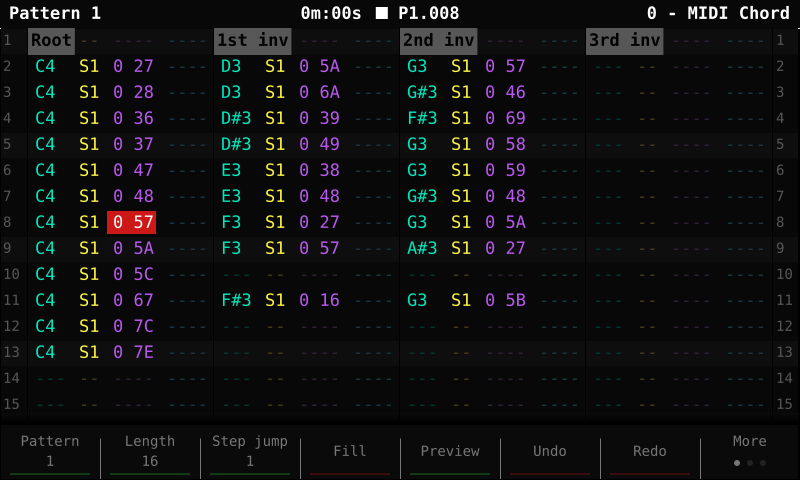
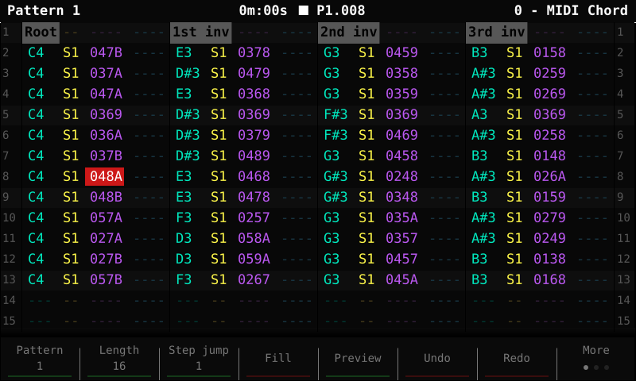
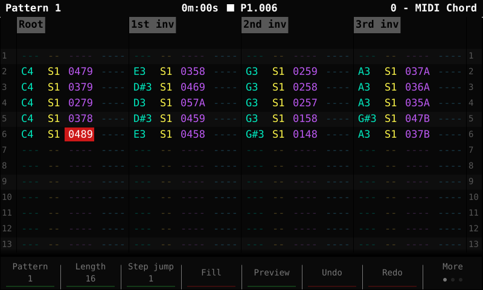

# Chords

The 1.2.0 mods' chord inversions are part of CE now, as its **MIDI Chord** FX (FX letter **0**).
This page shows which value gives which chord, with each chord in C and every inversion CE has.

- The FX plays on synth and MIDI instruments.
- The step's note is the chord's lowest note. The value lists the other notes, as semitones above it:
  `0` then digits, with A = 10, B = 11, C = 12 and E = 14. From G3, `059` plays G3, C4 (5 above)
  and E4 (9 above): C major with G in the bass.
- With an Arp FX in the step's other FX column, the chord's notes are played one at a time, as the
  arpeggio, instead of together.

## Use it

1. Put a note on a step with a synth or MIDI instrument: the chord's lowest note.
2. Set one of the step's FX columns to **0 - MIDI Chord**.
3. Turn the jog wheel to pick the value.

For C major on C4, the step is `C4` with `047`. For its 2nd inversion it is `G3` with `059`.

The pictures are drawn from the firmware's code, at the screen's 800 × 480. Each is a 16-step
pattern on synth 1 with one chord per step from step 2, and the tracks named for the inversion they
hold: root position in Track 1, the 1st inversion in Track 2, and so on. Nothing is marked, since
the FX is CE's. The font is close to the unit's, not the same.

Root position starts on C4. An inversion starts on that chord note in the octave below, so the
chord still reaches C4: the 1st inversion starts on the 3rd, the 2nd on the 5th, the 3rd on the 7th
or 6th. The screen writes notes with sharps, so Eb3 shows as D#3; the tables spell each note as in
the chord.

## 3-note chords

*Twelve 3-note chords. The FX column shows `0` and the value, right-aligned, so `057` shows as
`0 57`. Open4, Open5 and Open sus2 span an octave or more and have no inversions.*

Each table cell is the step's note and the FX value, then the notes that play.

| Step | Chord | Root position | 1st inversion | 2nd inversion |
|---|---|---|---|---|
| 2 | Sus2 | `C4` `027` (C4 D4 G4) | `D3` `05A` (D3 G3 C4) | `G3` `057` (G3 C4 D4) |
| 3 | Sus2#5 | `C4` `028` (C4 D4 G#4) | `D3` `06A` (D3 G#3 C4) | `G#3` `046` (G#3 C4 D4) |
| 4 | Diminished | `C4` `036` (C4 Eb4 Gb4) | `D#3` `039` (Eb3 Gb3 C4) | `F#3` `069` (Gb3 C4 Eb4) |
| 5 | Minor | `C4` `037` (C4 Eb4 G4) | `D#3` `049` (Eb3 G3 C4) | `G3` `058` (G3 C4 Eb4) |
| 6 | Major | `C4` `047` (C4 E4 G4) | `E3` `038` (E3 G3 C4) | `G3` `059` (G3 C4 E4) |
| 7 | Augmented | `C4` `048` (C4 E4 G#4) | `E3` `048` (E3 G#3 C4) | `G#3` `048` (G#3 C4 E4) |
| 8 | Sus4 | `C4` `057` (C4 F4 G4) | `F3` `027` (F3 G3 C4) | `G3` `05A` (G3 C4 F4) |
| 9 | Stacked 4ths | `C4` `05A` (C4 F4 Bb4) | `F3` `057` (F3 Bb3 C4) | `A#3` `027` (Bb3 C4 F4) |
| 10 | Open4 | `C4` `05C` (C4 F4 C5) |  |  |
| 11 | Sus#4 | `C4` `067` (C4 F#4 G4) | `F#3` `016` (F#3 G3 C4) | `G3` `05B` (G3 C4 F#4) |
| 12 | Open5 | `C4` `07C` (C4 G4 C5) |  |  |
| 13 | Open sus2 | `C4` `07E` (C4 G4 D5) |  |  |

An augmented chord's inversions are the same shape again, so they are all `048`. Sus2, Sus4 and
Stacked 4ths are each other's inversions.

## 7th chords

*Twelve 4-note chords with a 7th, each with three inversions.*

| Step | Chord | Root position | 1st inversion | 2nd inversion | 3rd inversion |
|---|---|---|---|---|---|
| 2 | Maj7 | `C4` `047B` (C4 E4 G4 B4) | `E3` `0378` (E3 G3 B3 C4) | `G3` `0459` (G3 B3 C4 E4) | `B3` `0158` (B3 C4 E4 G4) |
| 3 | Min7 | `C4` `037A` (C4 Eb4 G4 Bb4) | `D#3` `0479` (Eb3 G3 Bb3 C4) | `G3` `0358` (G3 Bb3 C4 Eb4) | `A#3` `0259` (Bb3 C4 Eb4 G4) |
| 4 | Dom7 | `C4` `047A` (C4 E4 G4 Bb4) | `E3` `0368` (E3 G3 Bb3 C4) | `G3` `0359` (G3 Bb3 C4 E4) | `A#3` `0269` (Bb3 C4 E4 G4) |
| 5 | Dim7 | `C4` `0369` (C4 Eb4 Gb4 Bbb4) | `D#3` `0369` (Eb3 Gb3 Bbb3 C4) | `F#3` `0369` (Gb3 Bbb3 C4 Eb4) | `A3` `0369` (Bbb3 C4 Eb4 Gb4) |
| 6 | m7b5 | `C4` `036A` (C4 Eb4 Gb4 Bb4) | `D#3` `0379` (Eb3 Gb3 Bb3 C4) | `F#3` `0469` (Gb3 Bb3 C4 Eb4) | `A#3` `0258` (Bb3 C4 Eb4 Gb4) |
| 7 | mMaj7 | `C4` `037B` (C4 Eb4 G4 B4) | `D#3` `0489` (Eb3 G3 B3 C4) | `G3` `0458` (G3 B3 C4 Eb4) | `B3` `0148` (B3 C4 Eb4 G4) |
| 8 | Aug7 | `C4` `048A` (C4 E4 G#4 Bb4) | `E3` `0468` (E3 G#3 Bb3 C4) | `G#3` `0248` (G#3 Bb3 C4 E4) | `A#3` `026A` (Bb3 C4 E4 G#4) |
| 9 | AugMaj7 | `C4` `048B` (C4 E4 G#4 B4) | `E3` `0478` (E3 G#3 B3 C4) | `G#3` `0348` (G#3 B3 C4 E4) | `B3` `0159` (B3 C4 E4 G#4) |
| 10 | 7sus4 | `C4` `057A` (C4 F4 G4 Bb4) | `F3` `0257` (F3 G3 Bb3 C4) | `G3` `035A` (G3 Bb3 C4 F4) | `A#3` `0279` (Bb3 C4 F4 G4) |
| 11 | Sus2b7 | `C4` `027A` (C4 D4 G4 Bb4) | `D3` `058A` (D3 G3 Bb3 C4) | `G3` `0357` (G3 Bb3 C4 D4) | `A#3` `0249` (Bb3 C4 D4 G4) |
| 12 | Sus2maj7 | `C4` `027B` (C4 D4 G4 B4) | `D3` `059A` (D3 G3 B3 C4) | `G3` `0457` (G3 B3 C4 D4) | `B3` `0138` (B3 C4 D4 G4) |
| 13 | Sus4maj7 | `C4` `057B` (C4 F4 G4 B4) | `F3` `0267` (F3 G3 B3 C4) | `G3` `045A` (G3 B3 C4 F4) | `B3` `0168` (B3 C4 F4 G4) |

CE's FX description calls `047A` Maj7. It is C, E, G, Bb, a dominant 7th; `047B` is the major 7th.
A diminished 7th's inversions are the same shape, so they are all `0369`; its Bbb is the
note A.

## 6th chords and others

*The 4-note chords left in CE's list.*

| Step | Chord | Root position | 1st inversion | 2nd inversion | 3rd inversion |
|---|---|---|---|---|---|
| 2 | Maj6 | `C4` `0479` (C4 E4 G4 A4) | `E3` `0358` (E3 G3 A3 C4) | `G3` `0259` (G3 A3 C4 E4) | `A3` `037A` (A3 C4 E4 G4) |
| 3 | Min6 | `C4` `0379` (C4 Eb4 G4 A4) | `D#3` `0469` (Eb3 G3 A3 C4) | `G3` `0258` (G3 A3 C4 Eb4) | `A3` `036A` (A3 C4 Eb4 G4) |
| 4 | 6sus2 | `C4` `0279` (C4 D4 G4 A4) | `D3` `057A` (D3 G3 A3 C4) | `G3` `0257` (G3 A3 C4 D4) | `A3` `035A` (A3 C4 D4 G4) |
| 5 | m(b6) | `C4` `0378` (C4 Eb4 G4 Ab4) | `D#3` `0459` (Eb3 G3 Ab3 C4) | `G3` `0158` (G3 Ab3 C4 Eb4) | `G#3` `047B` (Ab3 C4 Eb4 G4) |
| 6 | Aug(add6) | `C4` `0489` (C4 E4 G#4 A4) | `E3` `0458` (E3 G#3 A3 C4) | `G#3` `0148` (G#3 A3 C4 E4) | `A3` `037B` (A3 C4 E4 G#4) |

## One value, two chords

Some values are one chord in root position and another chord's inversion. `0479` from C4 is C6;
from Eb3 it is Cm7 in 1st inversion (Eb, G, Bb, C), which is also Eb6. The steps above give the
note to start on for the chord you want.

Every one of CE's 67 chord values is in these tables.
