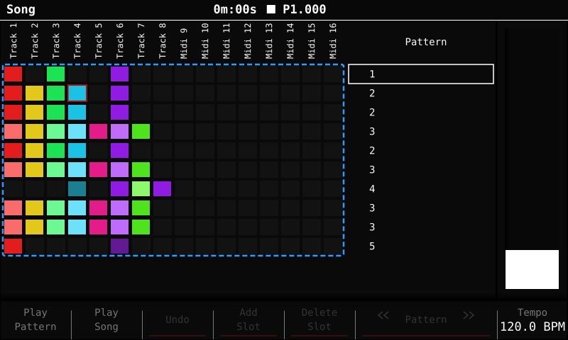

# Color Song

The Song screen's blocks get a colour from what they hold, so the same material is easy to follow
through a song.

- Turn it on in **Project Settings → Mods → Color Song** (for new projects: **Config → Mods**).
- Off: the Song screen is CE's, with white blocks.

The picture is drawn from the firmware's code, at the screen's 800 × 480. The dashed blue outline
marks what the mod changes. The font is close to the unit's, not the same.

## How blocks get their colour

- **Hue:** the instruments a block's track plays. Blocks that use the same instruments have the same
  hue.
- **Shade:** everything else: the steps, notes, instruments, FX and the pattern's length. Blocks with
  the same content have the same colour, in any column.
- **Micro-move (m) and Volume (V) don't count**, in their own columns or as FX. So
  [Humanize](humanize.md) doesn't change a block's colour.
- A block with only FX and no instruments is grey.

The first time a song is seen, the colours are handed out in song order: the first set of instruments
gets red, and each new one a hue further round the colour wheel. After that they stay put. Only an
edited block changes, to a colour nothing else in the song uses.

There are 20 hues and six shades of each. A song with more than 20 sets of instruments reuses hues,
and more than six different contents with the same instruments reuse shades.

## The Song screen

*A song of five patterns over ten positions: an intro (pattern 1), a verse (2), a chorus (3), a break
(4) and an outro (5). Marked: the blocks' colours.*

What the picture shows:

- **Track 1** plays one instrument all through, so its blocks are all red. The intro, verse and
  outro have the same part (red), the chorus a different one (light red).
- **Track 4** has three bass parts: verse (blue), chorus (light blue) and break (dark blue).
- **Track 6** has the same pad in the intro, verse and break (purple), another in the chorus (light
  purple) and a third in the outro (dark purple).
- **Track 8** in the break holds a copy of Track 6's pad, so it has the same purple.

## What else to know

- The mod changes only the fill of filled blocks. Empty blocks, the selection, the list and the text
  stay as they are. A muted track's blocks keep their colour, dimmed.
- The blocks keep their distance in lightness from the empty blocks, so they stay readable on any
  theme.
- When a song opens, a block can stay white a moment until the mod has read its pattern.
- The colours are saved with the project, in its `mods.bin`. A project that used Color Song with
  [Modular-Trackular](https://github.com/FatRodzianko/Modular-Trackular) on 1.2.0 keeps its colours:
  its `colorsong.bin` is read in the first time it opens.
- A colour changing after an edit doesn't mark the project changed. The edit already has.
