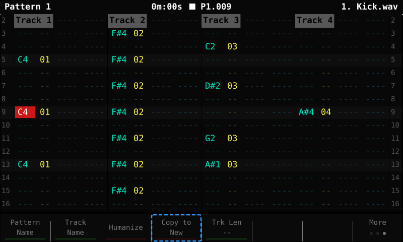
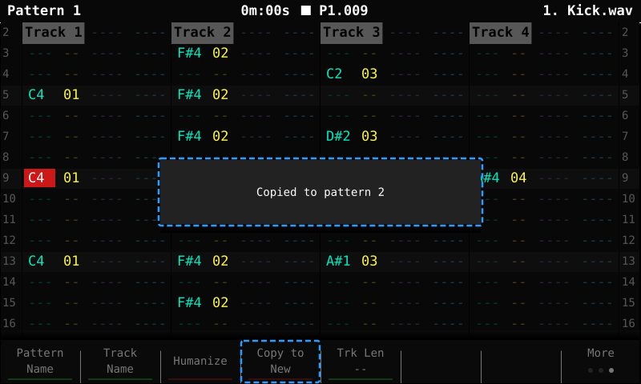

# Copy to New

A **Copy to New** button on the Pattern screen copies the pattern you're on into the next empty
pattern, with your unsaved edits, playing or stopped. You stay on your pattern.

- Turn it on in **Project Settings → Mods → Copy to New** (for new projects: **Config → Mods**).
- Off: the button isn't there, and nothing is written.

The pictures are drawn from the firmware's code, at the screen's 800 × 480. The dashed blue outline
marks what the mod adds. The font is close to the unit's, not the same.

## Copy a pattern

1. Turn edit mode on with **Rec**. The button only works in edit mode, and is greyed out otherwise.
2. Press **More** until the third page of buttons shows. The dots under More show the page.
3. Press **Copy to New**.

*Pattern 1 in edit mode. Marked: the Copy to New button. Its place on page 3 depends on which mods
are on: here Humanize, Copy to New and Track Length are all on.*

The mod looks for an empty pattern, writes the copy and says where it went. Pattern 1 stays open.

*After the copy. Marked: the popup with the number of the new pattern.*

## Which pattern it uses

The search starts at the pattern after yours and wraps round to 1. A pattern counts as empty only
when all of these hold:

- its block on the Song screen is empty;
- it isn't in the song, queued to play next, or played by a performance-mode track;
- it has no file, or every step of every track in its file is empty, all 128 steps, even past the
  pattern's length.

A note-off, an instrument without a note, an FX, a Volume or a Micro-move all count as something
in a step.

## What it copies

- The pattern as it is now, unsaved edits included.
- With [Track Length](tracklength.md) on, each track's own length too.

The copy is an ordinary CE pattern file.

## What the popup can say

- **Copied to pattern** and the number: done.
- **No empty pattern left**: every pattern is in use.
- **Pattern changed - try again**: you moved to another pattern before the copy was made.
- **Busy - try again**: the card was busy for 5 seconds.
- **Copy failed - SD card**: the copy couldn't be written.
- **Not in performance mode**: performance mode has changed the pattern on screen (the title says
  Pattern PERF), so there is nothing plain to copy.

While playing, the mod checks one pattern on the card at most every 100 ms, so a copy can take a
moment.
