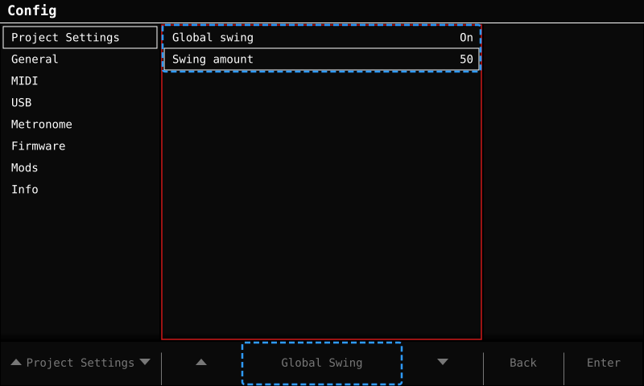
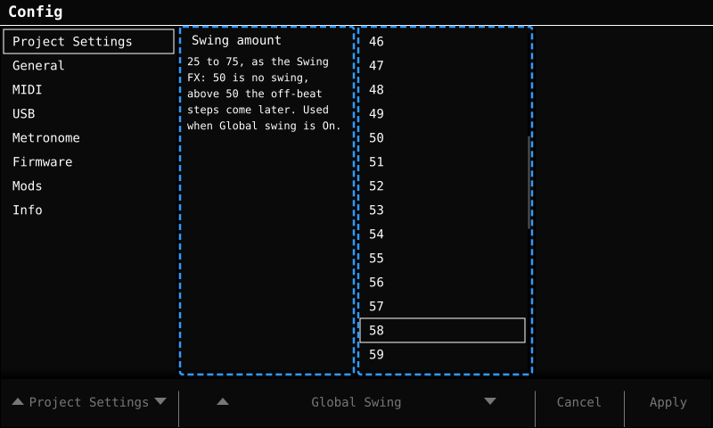

# Global Swing

One swing amount for the whole project. Every take and every pattern starts with it, so you don't
need a Swing FX at the top of each pattern.

- Turn it on in **Project Settings → Global Swing → Global swing**, or in **Project Settings → Mods
  → Global Swing**: they are the same switch. For new projects: **Config → Mods**.
- Off: the Swing FX works as in CE.

The pictures are drawn from the firmware's code, at the screen's 800 × 480. The dashed blue outline
marks what the mod adds. The font is close to the unit's, not the same.

## Set the amount

1. Open **Config**, then **Project Settings**, then **Global Swing**.
2. Select **Swing amount** and press **Enter**.
3. Turn the jog wheel to pick the amount and press **Apply**.

*The Global Swing group in Project Settings. Marked: its two items, and the group's name on the
bottom bar.*

*Swing amount open, 58 picked. Marked: the item's description and its values.*

| Setting | Default | What it does |
|---|---|---|
| Global swing | as Config → Mods | The mod's switch for this project. |
| Swing amount | 50 | 25 to 75, as the Swing FX: 50 is no swing, above 50 the off-beat steps come later. |

The settings are saved with the project. A project that used Global Swing with
[Modular-Trackular](https://github.com/FatRodzianko/Modular-Trackular) on 1.2.0 brings them the
first time it opens.

## How it plays

- Each take and each pattern start uses the Swing amount. A Swing FX still changes the swing, until
  the pattern starts again.
- A change to the amount while playing takes effect at once.
- In performance mode only a take's start uses it, not each pattern start, since performance tracks
  can have their own lengths and play backwards or at random.
- With an external MIDI clock, the clock sets the steps' timing, so swing has no effect, as with the
  Swing FX.
- Turning the mod Off leaves no swing until a Swing FX sets some.
