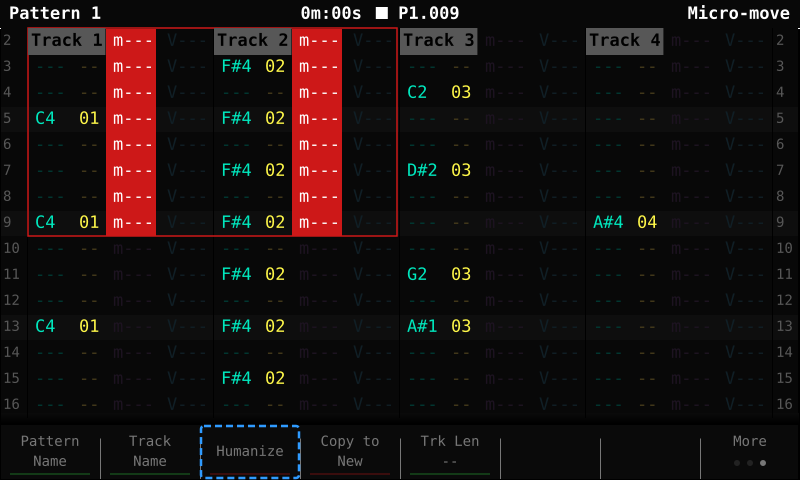
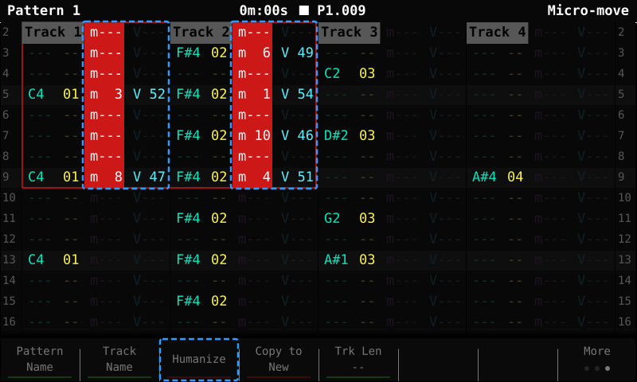

# Humanize

A **Humanize** button on the Pattern screen gives the selected notes small random changes in timing
and level. It writes them in CE's Micro-move (`m`) and Volume (`V`) columns, so the FX slots stay free.

- Turn it on in **Project Settings → Mods → Humanize** (for new projects: **Config → Mods**).
- Set how far it moves notes in **Project Settings → Humanize**.
- Off: the button isn't there.

The pictures are drawn from the firmware's code, at the screen's 800 × 480. The dashed blue outline
marks what the mod adds or changes. The font is close to the unit's, not the same.

## Humanize some notes

1. Turn edit mode on with **Rec**. The button only works in edit mode, and is greyed out otherwise.
2. Select the notes: hold **Shift** and move the cursor. With no selection, Humanize takes the
   cursor's whole track.
3. Press **More** until the third page of buttons shows. The dots under More show the page.
4. Press **Humanize**.

**Undo** takes the whole press back.

To see the `m` and `V` columns, as in the pictures, put the cursor in the note column and press
**Note**. That is CE's own view: the FX columns show Micro-move and Volume instead. Press **Note**
again to go back.

*Before: steps 2 to 9 of Tracks 1 and 2 are selected, and their `m` and `V` are empty (`m---`,
`V---`). Marked: the Humanize button. Its place on page 3 depends on which mods are on: here Humanize,
Copy to New and Track Length are all on.*

*After: each note in the selection has an `m` from 0 to 10 and a `V` from 45 to 55, the default
settings. Steps without a note are left alone. Marked: the changed `m` and `V` columns, and the
button.*

## What changes

Humanize changes every step in the selection that has a note. Empty steps and OFF, CUT and FADE are
left alone.

- **`m` (timing):** an empty `m` gets a random value from 0 to the Timing range. A value already there
  gets a random value in a window of the Timing range around it, within 0 to 100.
- **`V` (level):** an empty `V` gets a random value in a window of the Volume range around Sample
  volume (sample instruments) or MIDI velocity (MIDI and synth instruments). A value already there
  gets a window around itself, within 1 to 100. A `V` of 0 stays 0.
- Near a limit the window slides, so it stays inside.
- A step that has a Micro-move or Volume FX in an FX slot keeps it, and that FX's value is changed
  instead, since the FX wins over the column when the step plays.

With [Color Song](colorsong.md) on, a humanized block keeps its colour.

## Settings

**Project Settings → Humanize**, saved with the project:

| Setting | Default | What it does |
|---|---|---|
| Humanize | | The mod's switch for this project, as in Project Settings → Mods. |
| Timing range | 10 | How far timing moves. An empty `m` gets 0 to this value. |
| Volume/velocity | On | Off: Humanize changes only timing and leaves `V` alone. |
| Volume range | 10 | How wide the window for `V` is. |
| MIDI velocity | 50 | The centre for an empty `V` on MIDI and synth instruments. |
| Sample volume | 50 | The centre for an empty `V` on sample instruments. |

The numbers go from 1 to 100. A project that used Humanize with
[Modular-Trackular](https://github.com/FatRodzianko/Modular-Trackular) on 1.2.0 brings its settings
the first time it opens.
