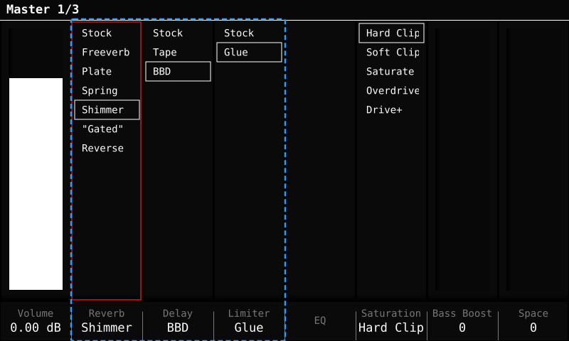
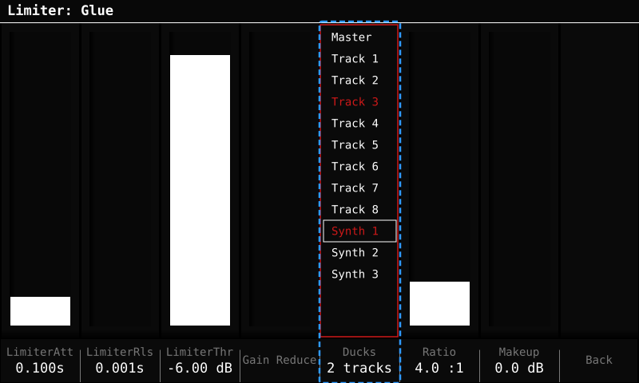
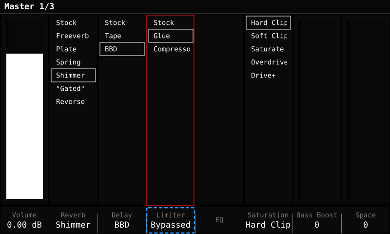
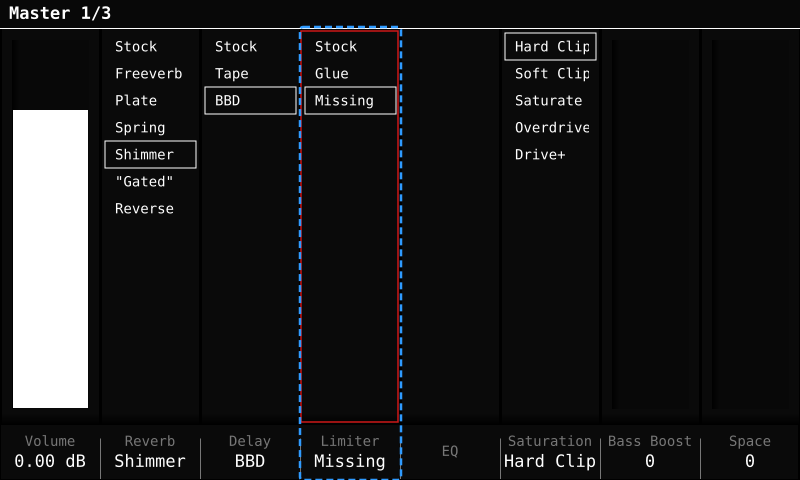

# Master FX

Three slots on the Master page, **Reverb**, **Delay** and **Limiter**, each playing CE's own effect
(**Stock**) or a plugin: a `.ptmfx` file from the card's `/MasterFX/` folder. Every send goes through
them as it does through CE's, synths included.

- Turn it on in **Project Settings → Mods → Master FX** (for new projects: **Config → Mods**). Off,
  every slot plays CE's effect, and the project keeps its choices.
- The firmware writes its default pack to `/MasterFX/` when a file is missing: the reverbs Freeverb,
  Plate, Spring, Shimmer, "Gated" and Reverse, the delays Tape and BBD, and the Glue compressor for
  the Limiter slot. Anyone can build more: [docs/masterfx_plugins.md](../masterfx_plugins.md).
- CE's knobs stay CE's. A plugin can give them its own names on the slot's page, and add up to two
  knobs of its own on the Reverb and Limiter pages.
- The choices are saved with the project: each slot's file and its own knobs, and the Ducks list.
  **Project Settings → Master FX** has the same three lists.
- Some plugins cost more CPU than CE's effects. With 8 synth voices, Shimmer and BBD together use
  most of it.

The pictures are drawn from the firmware's code, at the screen's 800 × 480. The dashed blue outline
marks what the mod adds or changes. The font is close to the unit's, not the same.

## Pick the effects

1. Open the Master page with **Master**.
2. Move to the **Reverb**, **Delay** or **Limiter** column with Left or Right. The red frame shows
   where you are.
3. Turn the jog wheel to pick. The pick plays at once, also while the song plays; the slot is
   silent for a moment while its memory is cleared.

Each list has **Stock**, then the slot's plugins on the card by their names, the default pack first.
Under each column is what plays. A name too long for the column is cut.

*Shimmer, BBD and Glue picked, the Reverb column selected. Marked: the three lists and the names
under them.*

## A slot's page

Press the button under **Reverb**, **Delay** or **Limiter** to open that slot's page. It is CE's
page. The title says what plays, and the plugin's names for CE's knobs replace CE's where it has
them. Shimmer calls Size, Damping and Diffusion **Decay**, **Tone** and **Shimmer**:

*The Reverb page with Shimmer. Marked: the title and Shimmer's names for CE's knobs.*

Press **Back** to go back to the Master page.

## A plugin's own knobs

A plugin's own knobs sit in the two columns before **Back**, on the Reverb and Limiter pages. Glue
has **Ratio** and **Makeup**:

1. Press the button under the knob.
2. Turn the jog wheel, or press Up or Down, to change it one step at a time.
3. Press **Delete** to set it back to the plugin's default.

*The Limiter page with Glue, Ratio selected. Marked: the title and Glue's own knobs.*

The Delay page has no free column, so a delay plugin's own knobs keep their defaults.

## Duck chosen tracks

A Limiter plugin that can duck (Glue can) turns chosen tracks down by its gain, instead of the whole
master. It follows the key you pick in CE's **Sidechain** list, for example the kick's track.

1. On the Limiter page, pick the key in the **Sidechain** list.
2. Hold **Shift** and press the button under **Sidechain**. The column becomes the **Ducks** list:
   **Master**, **Track 1** to **Track 8** and **Synth 1** to **Synth 3**.
3. Move the cursor with the jog wheel or Up and Down, and press the button under the column to mark
   or unmark the item under it. Marked items are red.
4. Under the column is what is ducked: **Master**, the one track, or the number of tracks.
5. **Master**, or **Delete**, unmarks them all: the plugin works on the whole master again.
6. Hold **Shift** and press the button again to go back to the **Sidechain** list. The page always
   opens on it.

*Track 3 and Synth 1 marked: the key turns those two down and leaves the rest of the mix alone.
Marked: the Ducks list and its column.*

The Ducks list is there only while a plugin that can duck plays in the Limiter slot. A track's sends
to the reverb and delay aren't ducked.

## Bypassed

A plugin that takes too long is stopped, so the audio keeps playing: the slot passes its sound
through. Its column on the Master page says **Bypassed**, and its page's title ends in
**(bypassed)**. It stays bypassed until you pick something else in the slot and then the plugin
again, or turn the mod off and on.

*The Limiter slot's plugin was stopped. Marked: Bypassed under the Limiter column.*

## Missing

When the project's plugin isn't on the card, the slot plays **Stock** meanwhile. The list and the
column say **Missing**, and the slot's page title names the file, for example
**Limiter: Missing: Ducker.ptmfx**. (The default pack's files are written again by the firmware, so
they don't go missing.)

Copy the file to `/MasterFX/` on the card. The firmware looks for it again when you open a project
or the Master page.

*The project's Limiter plugin isn't on the card. Marked: the Limiter list and its column.*
