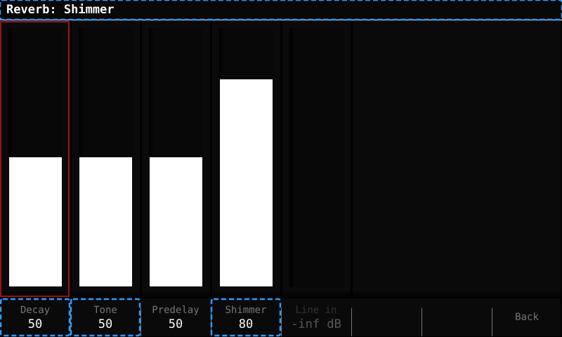
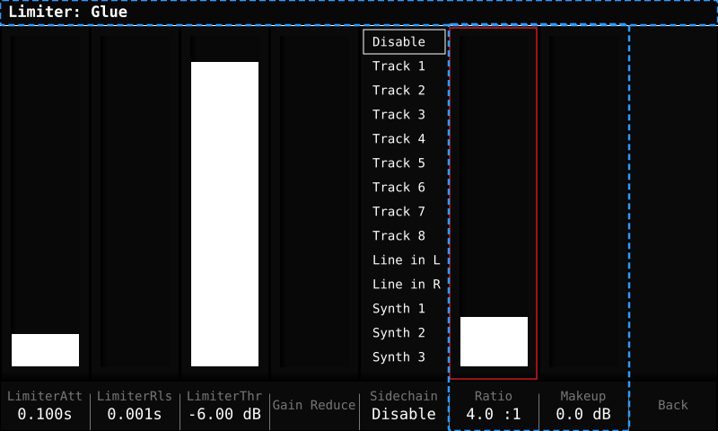
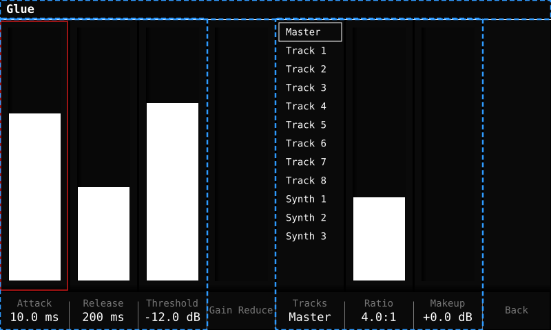
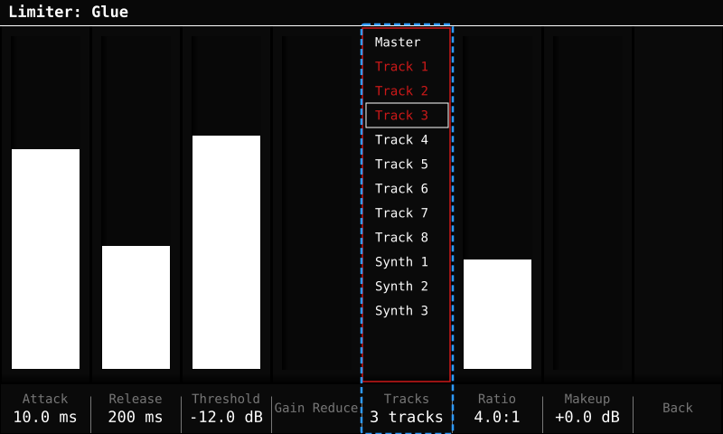

# Master FX

Three slots on the Master page, **Reverb**, **Delay** and **Limiter**, each playing CE's own effect
(**Stock**) or a plugin: a `.ptmfx` file from the card's `/MasterFX/` folder. Every send goes through
them as it does through CE's, synths included.

- Turn it on in **Project Settings → Mods → Master FX** (for new projects: **Config → Mods**). Off,
  every slot plays CE's effect, and the project keeps its choices.
- The firmware writes its default pack to `/MasterFX/` when a file is missing: the reverbs Freeverb,
  Plate, Spring, Shimmer, "Gated" and Reverse, the delays Tape and BBD, and the compressors Glue and
  Compressor for the Limiter slot ([what each one does](#the-default-plugins)). Anyone can build
  more: [docs/masterfx_plugins.md](../masterfx_plugins.md).
- A pack file the firmware wrote before, still as it wrote it, is replaced when a new firmware has a
  new version of it. A file you changed, or one of your own, is left alone.
- CE's knobs stay CE's. A plugin can give them its own names on the slot's page, and add up to two
  knobs of its own on the Reverb and Limiter pages. A Limiter plugin can also have its own knobs in
  place of CE's **LimiterAtt**, **LimiterRls** and **LimiterThr** (Glue does).
- The choices are saved with the project: each slot's file and its own knobs, and the Ducks or
  Tracks list. **Project Settings → Master FX** has the same three lists.
- Some plugins cost more CPU than CE's effects. With 8 synth voices, Shimmer and BBD together use
  most of it.

The pictures are drawn from the firmware's code, at the screen's 800 × 480. The dashed blue outline
marks what the mod adds or changes. The font is close to the unit's, not the same.

## Pick the effects

1. Open the Master page with **Master**.
2. Move to the **Reverb**, **Delay** or **Limiter** column with Left or Right. The red frame shows
   where you are.
3. Turn the jog wheel to pick. The pick plays at once, also while the song plays; the slot is
   silent for a moment while its memory is cleared.

Each list has **Stock**, then the slot's plugins on the card by their names, the default pack first.
Under each column is what plays. A name too long for the column is cut.

*Shimmer, BBD and Glue picked, the Reverb column selected. Marked: the three lists and the names
under them.*

## A slot's page

Press the button under **Reverb**, **Delay** or **Limiter** to open that slot's page. It is CE's
page. The title says what plays, and the plugin's names for CE's knobs replace CE's where it has
them. Shimmer calls Size, Damping and Diffusion **Decay**, **Tone** and **Shimmer**:

*The Reverb page with Shimmer. Marked: the title and Shimmer's names for CE's knobs.*

Press **Back** to go back to the Master page.

## A plugin's own knobs

A plugin's own knobs sit in the two columns before **Back**, on the Reverb and Limiter pages.
Compressor has **Ratio** and **Makeup**:

1. Press the button under the knob.
2. Turn the jog wheel, or press Up or Down, to change it one step at a time.
3. Press **Delete** to set it back to the plugin's default.

*The Limiter page with Compressor, Ratio selected. Marked: the title and Compressor's own knobs.*

The Delay page has no free column, so a delay plugin's own knobs keep their defaults.

## Duck chosen tracks

A Limiter plugin that can duck (Compressor can) turns chosen tracks down by its gain, instead of the
whole master. It follows the key you pick in CE's **Sidechain** list, for example the kick's track.

1. On the Limiter page, pick the key in the **Sidechain** list.
2. Hold **Shift** and press the button under **Sidechain**. The column becomes the **Ducks** list:
   **Master**, **Track 1** to **Track 8** and **Synth 1** to **Synth 3**.
3. Move the cursor with the jog wheel or Up and Down, and press the button under the column to mark
   or unmark the item under it. Marked items are red.
4. Under the column is what is ducked: **Master**, the one track, or the number of tracks.
5. **Master**, or **Delete**, unmarks them all: the plugin works on the whole master again.
6. Hold **Shift** and press the button again to go back to the **Sidechain** list. The page always
   opens on it.

*Track 3 and Synth 1 marked: the key turns those two down and leaves the rest of the mix alone.
Marked: the Ducks list and its column.*

The Ducks list is there only while a plugin that can duck plays in the Limiter slot. A track's sends
to the reverb and delay aren't ducked.

## Glue on chosen tracks

Glue has its own page: its own **Attack**, **Release** and **Threshold** where CE's limiter knobs
were, **Gain Reduce**, the **Tracks** list, then **Ratio** and **Makeup**. Change a knob as above:
press the button under it, turn the jog wheel or press Up or Down, and **Delete** sets it back to
Glue's default.

*Glue on the master, as a new project has it. Marked: the title, Glue's own Attack, Release and
Threshold, the Tracks list and its Ratio and Makeup.*

With **Master** in the Tracks list, Glue works on the whole mix, as CE's limiter does. Pick tracks,
and it works only on those, all together, as one group: for example the drum tracks, glued into one
kit. The rest of the mix isn't touched.

1. On Glue's page, move to the **Tracks** column with Left or Right.
2. Move the cursor with the jog wheel or Up and Down, and press the button under the column to mark
   or unmark the item under it. Marked items are red.
3. Under the column is what Glue works on: **Master**, the one track, or the number of tracks.
4. **Master**, or **Delete**, unmarks them all: Glue works on the whole master again.

*Track 1, 2 and 3 marked: Glue compresses those three together and leaves the rest alone. Marked:
the Tracks list and its column.*

The Tracks list is always up on Glue's page: Glue has no key, so there's no **Sidechain** list.
A track's sends to the reverb and delay aren't compressed. Picking another Limiter plugin sets the
list back to **Master**.

On chosen tracks, Glue works where the tracks are mixed, before the mix's **Saturation** (on the
**Master 1/3** page). So the project's Saturation shapes the compressed tracks the same way it
shapes the rest of the mix.

## The default plugins

The ten plugins the firmware writes to `/MasterFX/`, in the order the lists show them: six reverbs
for the Reverb slot, two delays for the Delay slot, and Glue and Compressor for the Limiter slot.

The pack's reverbs and delays have no knobs of their own: they use CE's knobs on the slot's page,
with CE's ranges, and some give them other names. CE's knobs belong to the project, so the Stock
effect and every plugin in the slot share their settings. **Line in** stays CE's. The defaults below
are a new project's.

**Cost** is how much of the unit's time the plugin takes: the most it used, over every setting it was
tried at, as a share of one audio block (128 samples, 2.9 ms, at 600 MHz). The plugin checker counts
it in the emulator ([docs/masterfx_plugins.md](../masterfx_plugins.md#cost)). It is a count of
instructions, not a reading from the unit, where memory adds to it. A plugin that takes more than an
eighth of a block is stopped (**Bypassed**). On the unit, with 8 synth voices, Shimmer and BBD
together use most of the time.

### Freeverb (Reverb)

The classic Freeverb reverb, by Jezar at Dreampoint.

| Knob | What it changes | Range | Default |
|---|---|---|---|
| Size | How long it rings: a bigger room. | 0 to 100 | 50 |
| Damping | Higher is darker: it takes more treble out of the tail. | 0 to 100 | 50 |
| Predelay | A gap before the reverb starts: 0 to about 113 ms. | 0 to 100 | 50 |
| Diffusion | Higher smears the first echoes into a smoother wash; lower is grainier. | 0 to 100 | 80 |

Cost: up to 2.6 % of a block.

### Plate (Reverb)

A plate reverb, after the design Jon Dattorro published in 1997.

| Knob | What it changes | Range | Default |
|---|---|---|---|
| Decay (CE's Size) | How long it rings. | 0 to 100 | 50 |
| Damping | Higher is darker: it takes more treble out of the tail. | 0 to 100 | 50 |
| Predelay | A gap before the reverb starts: 0 to about 113 ms. | 0 to 100 | 50 |
| Diffusion | Higher makes the start of the reverb smoother and denser. | 0 to 100 | 80 |

Cost: up to 2.2 % of a block.

### Spring (Reverb)

A tank of two springs: a thin sound with the springs' drip and boing.

| Knob | What it changes | Range | Default |
|---|---|---|---|
| Decay (CE's Size) | How long it rings. | 0 to 100 | 50 |
| Damping | Higher is darker: each pass round the springs loses more treble. | 0 to 100 | 50 |
| Predelay | A gap before the reverb starts: 0 to about 113 ms. | 0 to 100 | 50 |
| Drip (CE's Diffusion) | More of the springs' falling, dripping chirp. | 0 to 100 | 80 |

Cost: up to 2.0 % of a block.

### Shimmer (Reverb)

A plate whose tail is shifted up an octave and fed back in, so each pass adds a layer an octave
higher and the tail rises into a bright, organ-like wash.

| Knob | What it changes | Range | Default |
|---|---|---|---|
| Decay (CE's Size) | How long it rings. | 0 to 100 | 50 |
| Tone (CE's Damping) | Higher is darker: it takes more treble out of the tail. | 0 to 100 | 50 |
| Predelay | A gap before the reverb starts: 0 to about 113 ms. | 0 to 100 | 50 |
| Shimmer (CE's Diffusion) | How much of the octave-up layer: at 0 it is a plain plate. | 0 to 100 | 80 |

Cost: up to 2.8 % of a block, the most of the reverbs.

### "Gated" (Reverb)

A dense burst of echoes that lasts exactly the set length and then stops, after the non-linear
programs of the AMS RMX16. Not a reverb behind a noise gate.

| Knob | What it changes | Range | Default |
|---|---|---|---|
| Length (CE's Size) | How long the burst lasts: 10 ms at 0 to 368 ms at 100. | 0 to 100 | 50 |
| Tone (CE's Damping) | Higher is darker. | 0 to 100 | 50 |
| Predelay | A gap before the reverb starts: 0 to about 113 ms. | 0 to 100 | 50 |
| Release (CE's Diffusion) | How the burst ends: a hard cut at 0, a fade over the whole length at 100. | 0 to 100 | 80 |

With Length and Predelay both near the top, the length is shortened so the two fit together.

Cost: up to 2.4 % of a block.

### Reverse (Reverb)

The same burst as "Gated", swelling up over its length and then cutting off, like a reverb played
backwards. Its knobs are "Gated"'s.

Cost: up to 2.4 % of a block.

### Tape (Delay)

A tape echo, after the Roland Space Echo. The echoes wobble a little, get darker and thinner each
time round, and saturate warmly instead of clipping.

| Knob | What it changes | Range | Default |
|---|---|---|---|
| PingPong | Off: the same echo on both sides. On: the echoes go right, left, right ... | Off, On | Off |
| Sync | On: the echo time follows the tempo, set by Rate. | Off, On | Off |
| Rate | The echo time as a note length, with Sync On. | 8 to 1/32 | 8 |
| Time | The echo time, with Sync Off. Changing it bends the echoes' pitch, as a tape machine changing speed. | 1 ms to 3500 ms | 500 ms |
| Feedback | How many times it repeats. Near the top the echoes build up and sustain; the saturation keeps them from growing without limit. | 0 to 99 | 50 |
| Filter | Cuts the treble of every echo, the first included: lower is darker. | 100 Hz to 20000 Hz | 20000 Hz |

Cost: up to 1.5 % of a block.

### BBD (Delay)

An analog delay chip, after pedals such as the Boss DM-2: the longer the time, the darker the
echoes (about 7 kHz at 100 ms, 2.4 kHz at 300 ms, 600 Hz at the longest), with a little grit.

| Knob | What it changes | Range | Default |
|---|---|---|---|
| PingPong | Off: the same echo on both sides. On: the echoes go right, left, right ... | Off, On | Off |
| Sync | On: the echo time follows the tempo, set by Rate. | Off, On | Off |
| Rate | The echo time as a note length, with Sync On. | 8 to 1/32 | 8 |
| Time | The echo time, with Sync Off. It also sets how dark the echoes are. Changing it sweeps the pitch briefly. | 1 ms to 3500 ms | 500 ms |
| Feedback | How many times it repeats. Near the top the echoes sustain. | 0 to 99 | 50 |
| Filter | Cuts the treble of every echo, the first included: lower is darker. | 100 Hz to 20000 Hz | 20000 Hz |

Cost: up to 2.0 % of a block.

### Glue (Limiter)

A bus compressor in place of CE's limiter, with its own Attack, Release and Threshold: it turns the
mix down when it gets loud, gently, so the parts sit together. It works on the whole master or on
chosen tracks, together (see [Glue on chosen tracks](#glue-on-chosen-tracks)). It follows the
louder side, so the stereo picture stays put, and it pays little attention to the lowest bass.

| Knob | What it changes | Range | Default |
|---|---|---|---|
| Attack | How fast it turns down when the level rises. | 0.10 ms to 100 ms, 20 steps a tenfold | 10.0 ms |
| Release | How fast it comes back up when the level falls. | 50 ms to 2.00 s, 6 steps a doubling | 200 ms |
| Threshold | The level it starts turning down at; the change starts gently, 3 dB below it. | -40.0 dB to 0.0 dB, in 0.5 dB steps | -12.0 dB |
| Tracks | Master: the whole mix. Marked tracks: only those, together. | Master, Track 1 to Track 8, Synth 1 to Synth 3 | Master |
| Ratio | How strongly it turns down past Threshold: 1.0:1 does nothing, 10.0:1 is strong. | 1.0:1 to 10.0:1, in 0.1 steps | 4.0:1 |
| Makeup | Lifts the result. On the master nothing limits it after that: past full scale the sound clips. On chosen tracks the result goes through the mix's Saturation, as the tracks do. | +0.0 dB to +12.0 dB, in 0.5 dB steps | +0.0 dB |

Gain Reduce shows how far it turns down, without the Makeup.

Cost: up to 0.4 % of a block, and about 0.4 % more for the firmware's handling around it. On
chosen tracks, about 0.03 % more again with one track playing, and about 0.06 % for each other
marked track that plays.

### Compressor (Limiter)

Master FX 2.0's Glue, renamed: a compressor in place of CE's limiter, with CE's knobs. It turns the
whole mix down when it gets loud, or follows a key and ducks chosen tracks (see
[Duck chosen tracks](#duck-chosen-tracks)). It follows the louder side, so the stereo picture stays
put, and it pays little attention to the lowest bass.

| Knob | What it changes | Range | Default |
|---|---|---|---|
| LimiterAtt (CE's) | How fast it turns down when the level rises. | 0.001 s to 1.000 s | 0.100 s |
| LimiterRls (CE's) | How fast it comes back up when the level falls. | 0.001 s to 1.000 s | 0.001 s |
| LimiterThr (CE's) | The level it starts turning down at; the change starts gently, 3 dB below it. | up to 0.00 dB | −6.00 dB |
| Sidechain (CE's) | Disable: it follows the mix. Anything else: it follows that (the key), and the key keeps its own level. | Disable, the eight tracks, Line in L, Line in R, Synth 1 to Synth 3 | Disable |
| Ratio | How strongly it turns down past LimiterThr: 1.0:1 does nothing, 20.0:1 is nearly a limiter. | 1.0:1 to 20.0:1, in 0.5 steps | 4.0:1 |
| Makeup | Lifts the result. Nothing limits it after that: past full scale the sound clips. | +0.0 dB to +12.0 dB, in 0.5 dB steps | +0.0 dB |

Gain Reduce shows how far it turns down, without the Makeup.

Cost: up to 0.5 % of a block, and about 0.4 % more for the firmware's handling around it (0.6 % with
a key).

### Projects from Master FX 2.0

In 2.0, the Limiter slot's compressor was called Glue; it's Compressor now. The firmware replaces
2.0's `Glue.ptmfx` with the new Glue, so a project saved with 2.0's Glue opens with the new Glue,
and its Ratio and Makeup come back as the new Glue's first two knobs, Attack and Release. To get
2.0's sound, pick **Compressor** in the Limiter list and set its Ratio and Makeup again.

## Bypassed

A plugin that takes too long is stopped, so the audio keeps playing: the slot passes its sound
through. Its column on the Master page says **Bypassed**, and its page's title ends in
**(bypassed)**. It stays bypassed until you pick something else in the slot and then the plugin
again, or turn the mod off and on.

*The Limiter slot's plugin was stopped. Marked: Bypassed under the Limiter column.*

## Missing

When the project's plugin isn't on the card, the slot plays **Stock** meanwhile. The list and the
column say **Missing**, and the slot's page title names the file, for example
**Limiter: Missing: Ducker.ptmfx**. (The default pack's files are written again by the firmware, so
they don't go missing.)

Copy the file to `/MasterFX/` on the card. The firmware looks for it again when you open a project
or the Master page.

*The project's Limiter plugin isn't on the card. Marked: the Limiter list and its column.*
