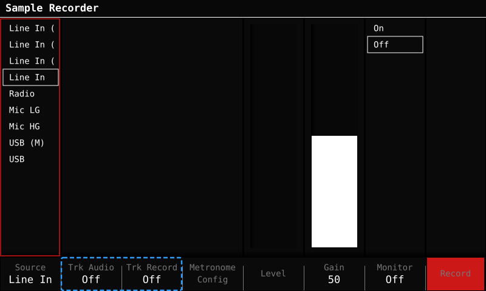
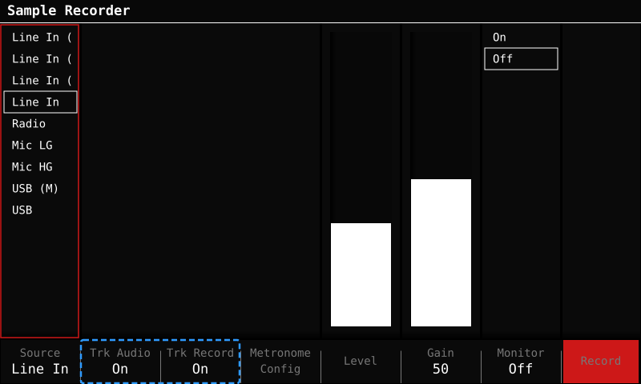
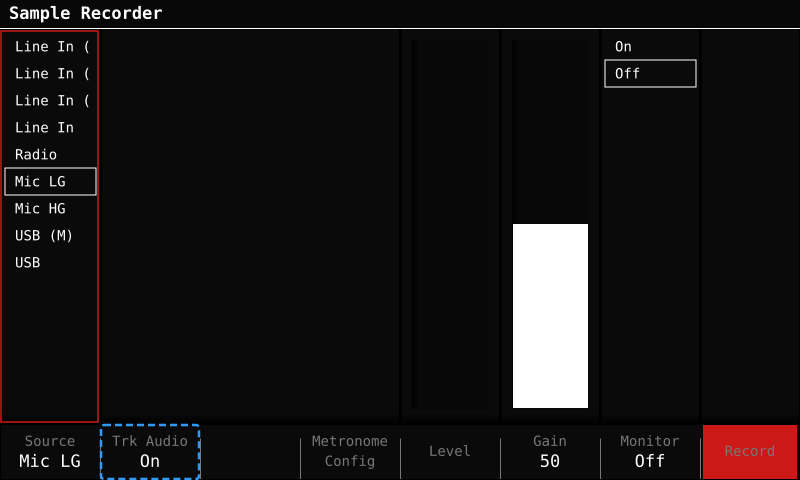

# Resample

Record the tracker itself in the Sample Recorder, on its own or together with what comes in on the
Line In. Two buttons on the recorder's screen, **Trk Audio** and **Trk Record**, turn it on for a take.

- Turn it on in **Config → Project Settings → Mods → Resample**. For new projects: **Config → Mods
  → Resample**.
- Off, or with both buttons Off: the Sample Recorder works as in CE.

The pictures are drawn from the firmware's code, at the screen's 800 × 480. The dashed blue outline
marks what the mod adds. The font is close to the unit's, not the same.

## The buttons

Open the Sample Recorder. With **Line In** as the Source, the two columns after Source hold the
buttons. Press the key under a button to switch it between Off and On.

*Line In, both buttons Off: the recorder as CE's. Marked: the two buttons.*

| Button | Sources | Default | What it does |
|---|---|---|---|
| Trk Audio | Line In (L), Line In (R), Line In (M), Line In, Mic LG, Mic HG | Off | The tracker is heard while the recorder is open, and Play starts it. |
| Trk Record | Line In | Off | The take records the tracker together with the Line In. |

- Turning **Trk Record** On turns **Trk Audio** On too.
- Turning **Trk Audio** Off turns **Trk Record** Off, and stops a pattern that's playing.
- **Trk Record** is there only with **Line In**, which records in stereo. **Line In (L)**, **(R)**
  and **(M)** record one channel and have only Trk Audio, as the mics do.
- **Radio**, **USB (M)** and **USB** have no buttons. Radio shows its own controls in those columns,
  and with USB the jacks already play the USB input.

The buttons are saved with the project: a press marks the project as changed, as any edit does. A
project that used live resampling with [Modular-Trackular](https://github.com/FatRodzianko/Modular-Trackular)
on 1.2.0 brings its buttons the first time it opens.

## Hear the tracker while you record

*Trk Audio On. Marked: the two buttons.*

1. Select one of the four **Line In** sources, **Mic LG** or **Mic HG** as the Source.
2. Press the key under **Trk Audio** so it shows **On**.
3. Press **Play** to hear the pattern, or **Shift + Play** for the song, and set the **Gain** for
   your input while it plays.
4. Press **Rec** to start the take, then **Play** to start the pattern during it. Or press
   **Shift + Rec** to start the take and the pattern from its start together.
5. Press **Rec** again to stop. The pattern stops with the take.

Only the input is recorded. The tracker is there to play along with.

- A pattern started by a MIDI Start from another device is heard too.
- During the count-in (Pre Roll), **Play** or **Shift + Rec** makes the pattern start with the take,
  and **Shift + Play** the song. Nothing plays until the count-in ends.
- **Shift + Rec** while the pattern plays starts it again from its start, with the take.
- With Trk Audio on, a take goes into free memory after the project's samples, so the samples stay
  as they are. If less than 10 seconds is free there, the take goes where CE puts it, over the
  samples, and the tracker stays silent until you leave the Sample Recorder, which reloads the
  samples. The same happens after a take recorded with Trk Audio Off.

## Record the tracker

*Line In with both buttons On. Marked: the two buttons.*

1. Select **Line In** as the Source: the stereo one, not (L), (R) or (M).
2. Press the key under **Trk Record** so it shows **On**. Trk Audio turns On with it.
3. Start the take as above: **Rec** then **Play**, or **Shift + Rec**.

The take holds what comes in on the Line In and what the tracker plays, added together. With
nothing plugged in, it's the tracker alone.

- **Monitor On:** you hear the Line In through the tracker, so the take is the tracker's sound,
  with the Line In in it once.
- **Monitor Off:** the take adds the Line In to the tracker's sound.
- What's recorded: samples, synths, Synth FX, the delay and reverb (Master FX's when it's on), and a
  monitored Line In. Not recorded: the metronome's clicks (you still hear them), sample previews,
  and MIDI out.
- The **Volume** knob doesn't change how loud the tracker is recorded.
- A loud mix and a loud Line In together can clip.

## Mono Line Ins, mics and USB

*Line In (L): only Trk Audio. Line In (R) and (M) look the same. Marked: the button.*

*Mic LG: only Trk Audio. Marked: the button.*

*USB: nothing marked. The screen is CE's, and the same for USB (M).*

## Play instruments in the recorder

With Trk Audio on, the recorder's instrument list has every instrument: samples, synths and MIDI.
With it off, the list is MIDI only, as in CE.

- The pads and a MIDI controller play the instrument. You hear it, and Trk Record records it.
- A note plays on the cursor's track, or the next track that's free and not muted. When none is
  free, it takes a sample track whose note has ended. Otherwise the note is dropped.
- Nothing is written into the pattern, with record mode on or off.
- Leaving the recorder gives the other screens back the instrument they had.
