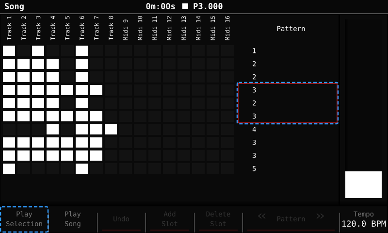
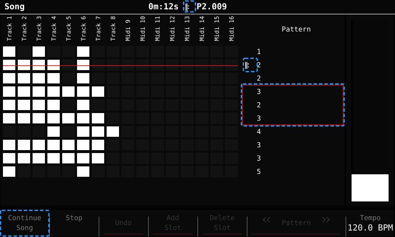
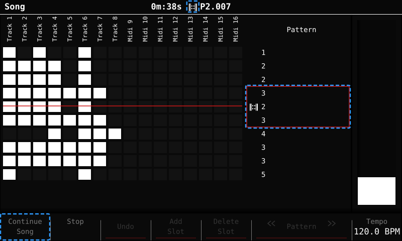

# Song Loop

Repeat a block of song positions while the song plays, then go on with the song when you're ready.
Designed by P-N-E-M for 1.2.0; this is the same design on CE.

- Turn it on in **Project Settings → Mods → Song Loop** (for new projects: **Config → Mods**).
- Nothing is saved: a loop lasts until Stop.
- Off: the Song screen is CE's.

The pictures are drawn from the firmware's code, at the screen's 800 × 480. The dashed blue outline
marks what the mod adds or changes. The repeat signs are drawn from the mod's pixel pattern; the font
is close to the unit's, not the same.

## Select a block

1. On the Song screen, turn **Rec** on and move the cursor to the pattern column.
2. Put the cursor on the block's first position.
3. Hold **Shift** and press **Down** to take in more positions. **Shift + Up** takes the bottom one
   back; the first position stays put.

A block needs at least two positions. The frame covers the whole block, and the left button reads
**Play Selection**. While there is a block, **Undo**, **Add Slot**, **Delete Slot** (and the Delete
key) and **<< Pattern >>** (and Shift + jog wheel) do nothing and are greyed out.

*Positions 4 to 6 selected, stopped. Marked: the block's frame and Play Selection.*

## Play the loop

Press **Play Selection**:

- **Stopped:** the song plays from the block's first position and repeats the block.
- **Playing, the block ahead:** the song plays on and repeats the block once it gets there. Until
  then the loop is armed: the status bar and the list show **|:** where the play icon was.
- **Playing, the block behind:** the song goes to the block's start at the end of the pattern.

*Armed: the song plays position 2 and will loop the block when it gets there. Marked: the block,
Continue Song, and the **|:** sign in the status bar and in the list.*

Once the song is in the block, the status bar and the list show **|: :|**.

*Looping: position 5 plays and the block repeats. Marked: the block (the list's sign is inside it),
Continue Song, and the **|: :|** sign in the status bar.*

## While it loops

- **Up** and **Down**, or the jog wheel, move the whole block.
- **Shift + Up** and **Shift + Down** make it shorter or longer, down to one position.
- **Continue Song** plays the block out, then the song goes on and the selection is gone.
- **Stop**, on any screen, ends the loop.

## How it plays

The loop is CE's Loop Performance for a block: Performance stays on for all of the block's patterns,
and Continue Song turns it off at the next pattern end, as CE's own Continue Song does.

With a Performance play mode other than Fwd on track 1, CE asks for the next pattern on track 1's
last row, which can then come too late or at random. With Song Loop on, the next pattern is asked
for on the last two rows of track 16 instead. That holds with or without a block.
