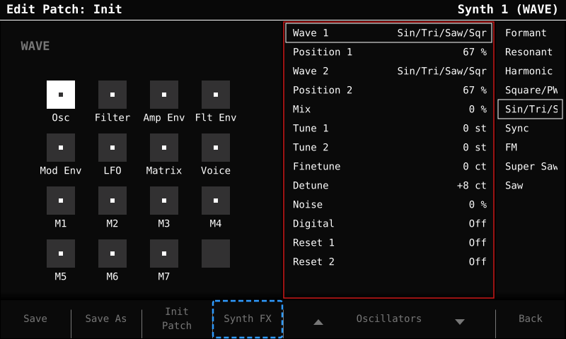
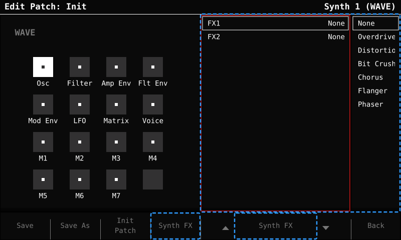
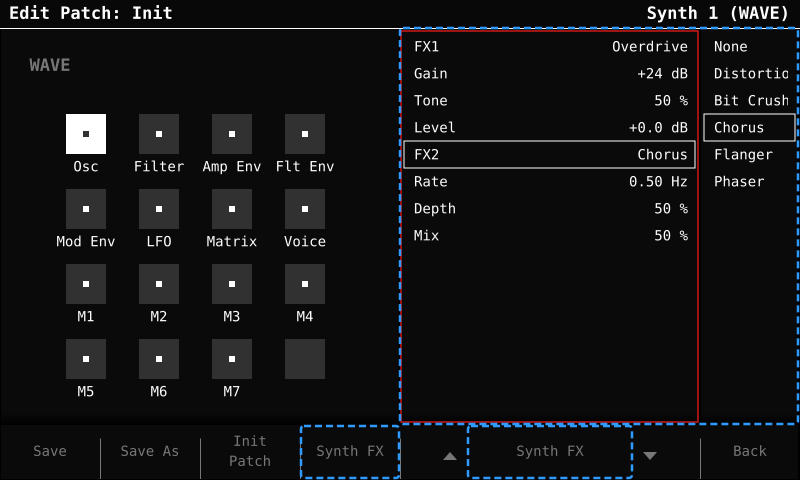
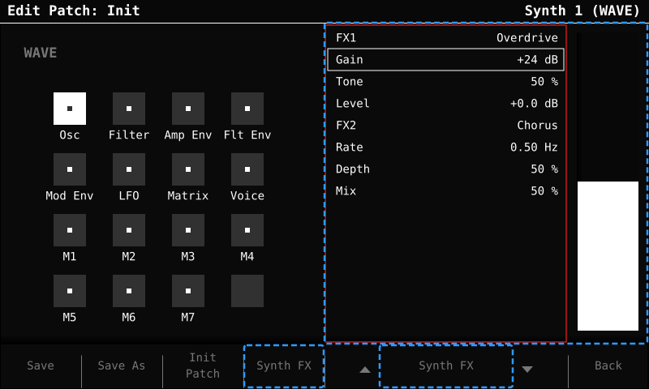

# Synth FX

Two effect slots, **FX1** then **FX2**, on each synth part, for every engine: CE's eight, and the
[Synths](synths.md) mod's WAVE and PHASE. Each slot runs one plugin, a `.ptsfx` file from the card's
`/SynthFX/` folder.

- Turn it on in **Project Settings → Mods → Synth FX** (for new projects: **Config → Mods**).
- The firmware writes its default pack to `/SynthFX/` when a file is missing: Overdrive, Distortion,
  Bit Crusher, Chorus, Flanger and Phaser. Anyone can build more:
  [docs/synthfx_plugins.md](../synthfx_plugins.md).
- The slots belong to the part, not the patch. Loading another patch keeps them, and they are saved
  with the project.
- A slot runs on the part after the engine. On PERC the effects reach the main output, not its sends.
- The Distortion and Phaser cost the most CPU: 8 DIRT voices with both on every part reach about 95 %.

The pictures are drawn from the firmware's code, at the screen's 800 × 480. The dashed blue outline
marks what the mod adds. The section icons are drawn as dots, and the font is close to the unit's,
not the same.

## Open the slots

1. Open a synth part's patch editor: on **Synth Parameters 1/2**, press **Edit Patch**.
2. Press **Synth FX**, the fourth button from the left.

*The patch editor, here on WAVE's Osc section. Marked: the Synth FX button.*

The parameter list now shows the part's slots: **FX1**, the knobs of FX1's plugin, **FX2**, the knobs
of FX2's plugin. Under the list it says **Synth FX**. Press **Synth FX** again, or pick a section with
the pads, to go back to the patch's own parameters.

## Pick a plugin

1. Select **FX1** or **FX2** with Up or Down. Column 8 lists the plugins: **None**, then each plugin in
   `/SynthFX/`, the default pack first.
2. Turn the jog wheel to pick one. The slot starts it once the wheel has been still a moment, so
   turning past a plugin doesn't start it.
3. Press **Delete** on the slot's row to set it to **None** at once.

*A part with no plugins, FX1 selected: column 8 lists None and the six plugins of the default pack.
Marked: the slots' rows, the plugin list, the Synth FX button and the list's name.*

A slot doesn't offer the plugin the other slot has. Here FX1 has Overdrive, so FX2's list leaves it
out:

*FX2 selected: its list has None, Distortion, Bit Crusher, Chorus, Flanger and Phaser, without FX1's
Overdrive. Marked: as above.*

## Set a plugin's knobs

Below each slot's row are its plugin's knobs, with the names and values the plugin gives them.

1. Select a knob with Up or Down. Column 8 shows its bar, or its choices for a knob with a few named
   steps.
2. Turn the jog wheel to change it.
3. Press **Delete** to set it back to the plugin's default.

*FX1 Overdrive and FX2 Chorus at their default knobs, with Overdrive's Gain selected. Marked: the
slots' rows and knobs, Gain's bar, the Synth FX button and the list's name.*

## What a slot's row can say

The slot's row shows the plugin's name while it runs. Otherwise it shows:

- **None**: no plugin.
- **Loading**: the plugin is being started.
- **Slow:** and the name: the plugin took too long and was stopped, so the part plays without it.
- **Missing**, **Bad file**, **Too big**, **No room**, **Safe mode**, **Read error** or **Not loaded**,
  and the name: the plugin couldn't start. Opening the slots again tries it again, for example after
  copying the file to the card.

## Old WAVE and PHASE patches

WAVE and PHASE used to have their own effects. An old patch has them moved into the slots. WAVE's old
Placement Pre is gone: a project saved with it opens with those effects in the slots, after the
engine.
