# Synths

Three more synth models for the synth parts: **WAVE**, a wavetable synth with two oscillators, a
filter, three envelopes, two LFOs and a mod matrix; **PHASE**, a phase distortion synth after the
Casio CZ; and **DCO6**, a virtual analog synth after the Roland Juno-106, with Unison and Vintage.

- Turn it on in **Project Settings → Mods → Synths** (for new projects: **Config → Mods**).
- They are `.psyn` files, `WAVE.psyn`, `PHASE.psyn` and `DCO6.psyn`, in the card's `Synths` folder beside
  CE's engines. Every release has them in `PolyendTracker_CE_Synths.zip` (install step 3 in the
  [README](../../README.md#install)).
- Their effects are the [Synth FX](synthfx.md) slots, on the Synth FX button in the patch editor.
- Off hides the three models in the picker. A part already playing one keeps it.

The pictures are drawn from the firmware's code, at the screen's 800 × 480. The dashed blue outline
marks what the mod adds. The section icons are drawn as dots, and the font is close to the unit's,
not the same.

## Pick WAVE, PHASE or DCO6

1. Open a synth part's **Synth Parameters 1/2** screen.
2. Press **Model**. The Model column gets the red frame.
3. Turn the jog wheel, or press Up or Down, to pick **WAVE**, **PHASE** or **DCO6**. Pressing **Model** again
   also steps to the next model.
4. Press **Edit Patch** to open the patch editor.

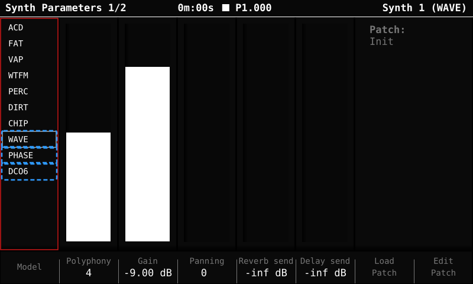

*The Model list with WAVE picked. Marked: the WAVE, PHASE and DCO6 rows. The right label shows the
part and its model, here Synth 1 (WAVE).*

## The patch editor

The patch editor is CE's. With WAVE, PHASE or DCO6 it shows their own sections and parameters:

- **Left:** a tile for each section, then the macros M1 to M7. The open section's tile is white.
  The four left pads of each pad row pick the tile in the same place: the top row of pads is the top
  row of tiles.
- **Middle (columns 5 to 7):** the section's parameters and their values. Up and Down, or the buttons
  under the arrows, move through them. The open section's name is under the list.
- **Right (column 8):** for a parameter with a list of choices, the choices; for a number, a bar.
  The jog wheel changes the value.
- **Save**, **Save As** and **Init Patch** work as on CE's engines. **Back** goes back to Synth
  Parameters.

The pictures show each model's Init patch, with each parameter at its default, unless the caption
says otherwise.

### WAVE

**Osc**: the two oscillators. *Wave 1* and *Wave 2* pick each oscillator's wavetable, or Super Saw
or Saw. *Position 1* and *Position 2* move through the wavetable; on Super Saw they set the spread of
its seven saws. *Mix* sets the balance between the oscillators, *Tune* and *Finetune* the pitch, and
*Detune* spreads them apart. *Noise* adds noise. *Digital* On plays the wavetables the way early
digital wavetable synths did: the nearest frame, 8-bit, no smoothing. *Reset* On starts the
oscillator's wave from the beginning at each note.

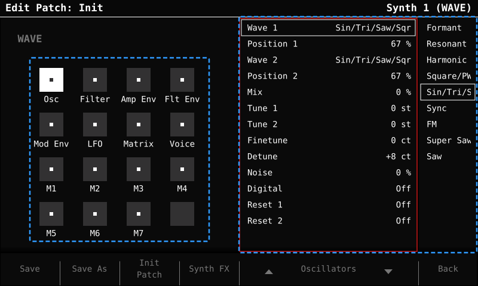

*Osc, with Wave 1 selected: column 8 lists the nine wavetables. Marked: WAVE's tiles and its
parameters, values and choices.*

**Filter**: *Cutoff*, *Resonance* (up to 150 %), the filter *Type*, *Env Amt* (from the Filter
Envelope), *Key Track* and *Drive*.

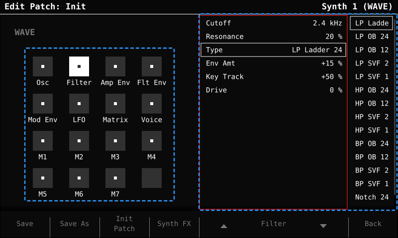

*Filter, with Type selected: the filter types in column 8, 14 of the 15 at a time. Marked: WAVE's
tiles and its parameters.*

**Amp Env**, **Flt Env** and **Mod Env**: three envelopes, each with Attack, Decay, Sustain and
Release. The amp envelope shapes the volume, the filter envelope the cutoff (by Env Amt), and the
mod envelope is a source for the matrix.

*Amp Env, with Amp Sustain selected: column 8 shows its bar. Marked: WAVE's tiles and its parameters.*

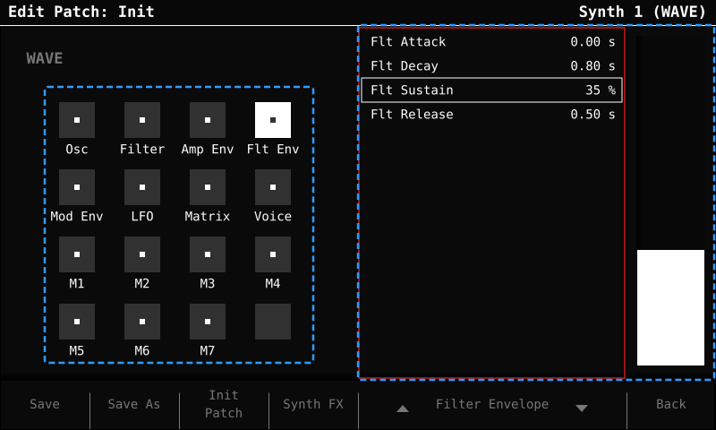

*Flt Env, with Flt Sustain selected. Marked: WAVE's tiles and its parameters.*

*Mod Env, with Mod Decay selected. Marked: WAVE's tiles and its parameters.*

**LFO**: two LFOs, five rows each. *Sync* On makes *Ratio* a note length instead of a rate in Hz.
*Wave* is the LFO's shape, *Retrigger* restarts it at each note (Note), runs it once (One Shot) or
lets it run (Free Running), and *Polarity* is Bipolar or Unipolar.

*LFO, with LFO 1 Wave selected: the six shapes in column 8. Marked: WAVE's tiles and its parameters.*

**Matrix**: six routings, three rows each: a source (*Src*), a destination (*Dest*) and an amount
(*Amt*, −400 % to +400 %). The Init patch has LFO 1 and the Mod Env routed to Position, at Amt 0 %,
ready to turn up.

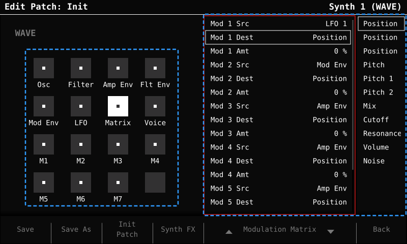

*Matrix, with Mod 1 Dest selected: the destinations in column 8. The list scrolls to Mod 5 and Mod 6.
Marked: WAVE's tiles and its parameters.*

**Voice**: *Glide Mode*, *Glide Time* and *Volume*.

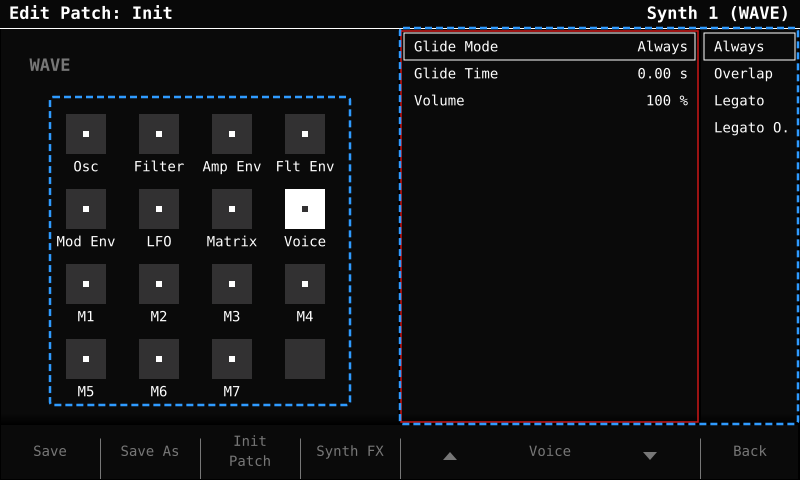

*Voice, with Glide Mode selected. Marked: WAVE's tiles and its parameters.*

### PHASE

**DCO**: the two oscillators. *Wave 1* and *Wave 2* pick each one's shape. *Wave 1+* and *Wave 2+*
pick a second shape that the oscillator plays on every other cycle, or Off. *Mix*, *Tune*,
*Finetune*, *Detune* and *Reset* work as on WAVE. *Ring Mod* On puts oscillator 1 × oscillator 2 in
place of oscillator 2. *Noise Mod* roughens oscillator 2 with noise: a roughness at 10 %, noise at
100 %.

*DCO, with Wave 1 selected: the eight shapes in column 8. Marked: PHASE's tiles and its parameters.*

**DCW**: the phase distortion's amount for each oscillator (*DCW 1*, *DCW 2*; at 0 most shapes are a
pure sine), how much the DCW Envelope moves each (*Env Amt 1*, *Env Amt 2*), and *Key Follow*, which
lowers or raises the DCW with the note, around middle C.

*DCW, with DCW 1 selected. Marked: PHASE's tiles and its parameters.*

**DCA**, **DCW Env** and **DCO Env**: three envelopes. DCA is the volume, DCW Env the distortion
amount, and DCO Env the pitch, by *DCO Env Amt* (up to ±48 semitones).

*DCA, with DCA Sustain selected. Marked: PHASE's tiles and its parameters.*

*DCW Env, with DCW Sustain selected. Marked: PHASE's tiles and its parameters.*

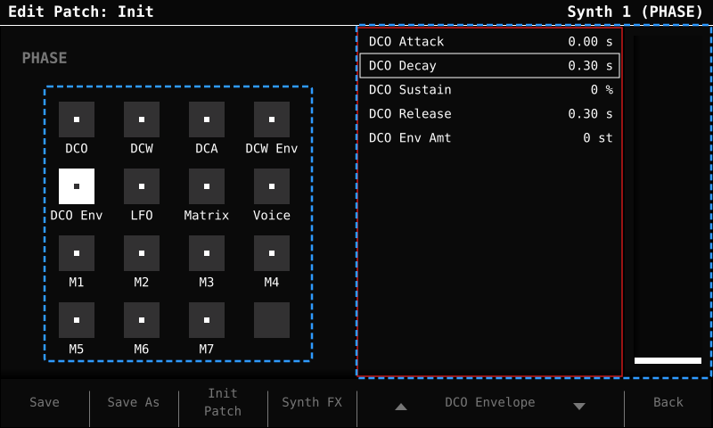

*DCO Env, with DCO Decay selected. Marked: PHASE's tiles and its parameters.*

**LFO**: the same two LFOs as WAVE's.

*LFO, with LFO 1 Wave selected. Marked: PHASE's tiles and its parameters.*

**Matrix**: six routings, with PHASE's sources (DCA Env, DCW Env, DCO Env, LFO 1, LFO 2, Velocity,
Key) and destinations. The Init patch has LFO 1 routed to Pitch and LFO 2 to DCW, at Amt 0 %.

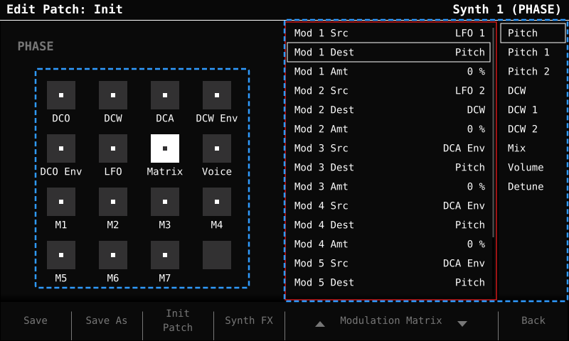

*Matrix, with Mod 1 Dest selected: the destinations in column 8. Marked: PHASE's tiles and its
parameters.*

**Voice**: *Glide Mode*, *Glide Time* and *Volume*, as on WAVE.

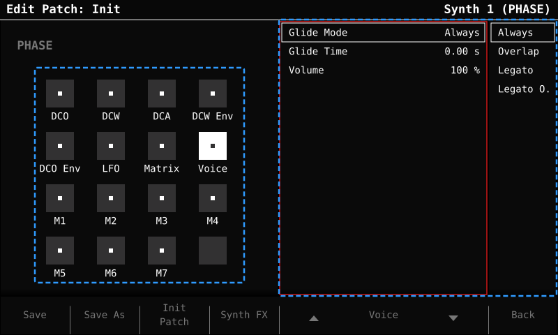

*Voice, with Glide Mode selected. Marked: PHASE's tiles and its parameters.*

### DCO6

DCO6 is built like the Roland Juno-106: one oscillator (DCO) per voice with a saw, a pulse, a sub
an octave down and noise; a high-pass and a resonant low-pass filter; one envelope for the filter and
the volume; and one LFO. To that it adds **Unison**, which stacks voices on each note, and
**Vintage**, which makes each voice a little different, as on an old analog synth. It plays in
stereo when Unison spreads a stack. It has no matrix and no glide modes: one Glide time.

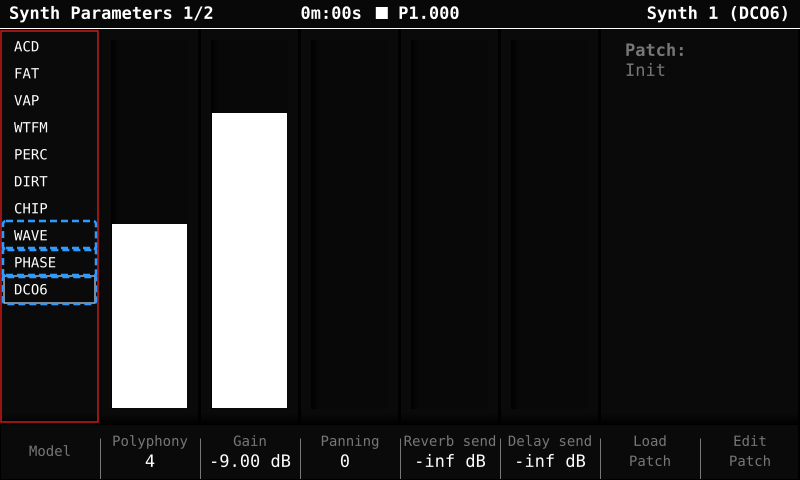

*The Model list with DCO6 picked. Marked: the WAVE, PHASE and DCO6 rows.*

**DCO**: the oscillator. Mix its four sources with *Saw*, *Pulse*, *Sub* and *Noise*; any mix of
them plays at once.

| Label | Range | Default | What it does |
|---|---|---|---|
| Range | 16', 8', 4' | 8' | the octave: down one, as played, up one |
| Saw | 0-100 % | 100 % | the saw's level |
| Pulse | 0-100 % | 0 % | the pulse's level |
| Sub | 0-100 % | 0 % | a square an octave down |
| Noise | 0-100 % | 0 % | white noise |
| Pulse Width | 0-100 % | 0 % | the pulse's width: a square at 0 %, thin at 100 % |
| PWM Amt | 0-100 % | 0 % | how much PWM Source moves the width |
| PWM Source | LFO, Env | LFO | what moves the width: the LFO or the envelope |
| LFO to Pitch | 0-100 % | 0 % | vibrato from the LFO; fine at the bottom, up to an octave at 100 % |
| Tune | −12 to +12 st | 0 st | the pitch in semitones |
| Fine Tune | −50 to +50 ct | 0 ct | the pitch in cents |

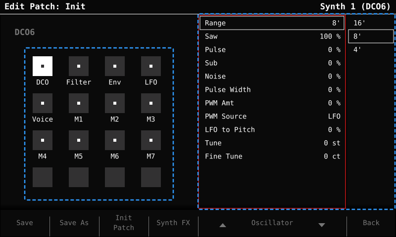

*DCO, with Range selected: its three choices in column 8. Marked: DCO6's tiles and its parameters.*

**Filter**: the low-pass, then the high-pass and Bass Boost.

| Label | Range | Default | What it does |
|---|---|---|---|
| Cutoff | 20 Hz-20 kHz | 2.4 kHz | the low-pass filter's cutoff |
| Resonance | 0-100 % | 15 % | the peak at the cutoff; at 100 % the filter rings on its own (self-oscillates) |
| Env Amt | −100 to +100 % | +35 % | how far the envelope moves the cutoff, up or (below 0) down |
| LFO to Cutoff | 0-100 % | 0 % | how far the LFO moves the cutoff |
| Key Track | 0-100 % | 50 % | how much the cutoff follows the note: 100 % moves it an octave per octave |
| HPF | Off, 20 Hz-2 kHz | Off | a high-pass filter that thins out the low end; at its lowest it's Off |
| Bass Boost | Off, On | Off | +6 dB below about 110 Hz; it can be on with the HPF |

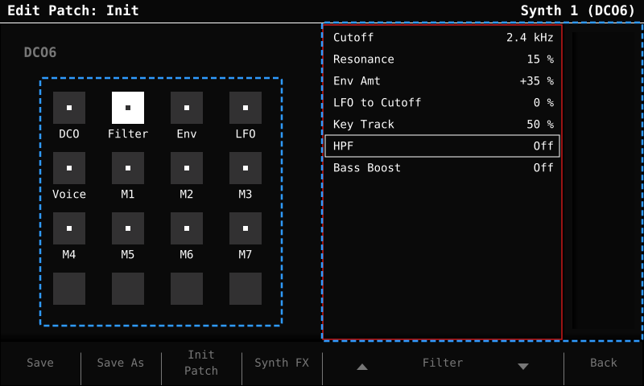

*Filter on the Init patch, with HPF selected: Off. Marked: DCO6's tiles and its parameters.*

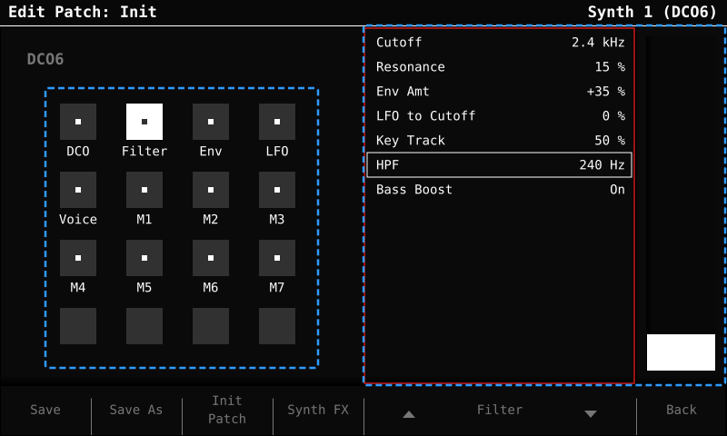

*Filter with the HPF at 240 Hz and Bass Boost On. Marked: DCO6's tiles and its parameters.*

**Env**: one envelope for the filter (by Env Amt) and the volume.

| Label | Range | Default | What it does |
|---|---|---|---|
| Attack | 1 ms-3 s | 5 ms, shown as 0.00 s | how long the envelope takes to rise |
| Decay | 1 ms-12 s | 0.60 s | how long it takes to fall to Sustain |
| Sustain | 0-100 % | 60 % | the level while the note is held |
| Release | 1 ms-12 s | 0.35 s | how long it takes to fall after the note ends |
| VCA Mode | Env, Gate | Env | Env: the volume follows the envelope. Gate: the volume is full while the note is held, and the envelope moves only the filter |

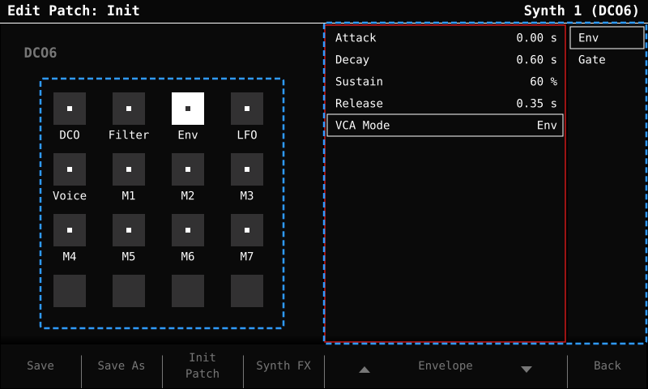

*Env, with VCA Mode selected: Env and Gate in column 8. Marked: DCO6's tiles and its parameters.*

**LFO**: one LFO for the pitch (LFO to Pitch), the pulse width (PWM Source LFO) and the cutoff (LFO
to Cutoff).

| Label | Range | Default | What it does |
|---|---|---|---|
| LFO Wave | Triangle, Sine, Square, Ramp Up, Ramp Down, Random S&H, Random Smooth | Triangle | the LFO's shape; Random S&H jumps to a new random level each cycle, Random Smooth glides between them |
| LFO Rate | 0.05-40 Hz; with LFO Sync, a note length | 5.14 Hz | the LFO's speed |
| LFO Sync | Off, On | Off | On: LFO Rate is a note length at the project's tempo |
| LFO Delay | 0-5 s | 0.00 s | the LFO fades in over this time after each note |
| LFO Trigger | Note, Free | Note | Note: the LFO starts again at each note. Free: all the part's voices share one LFO, as on the Juno-106 |

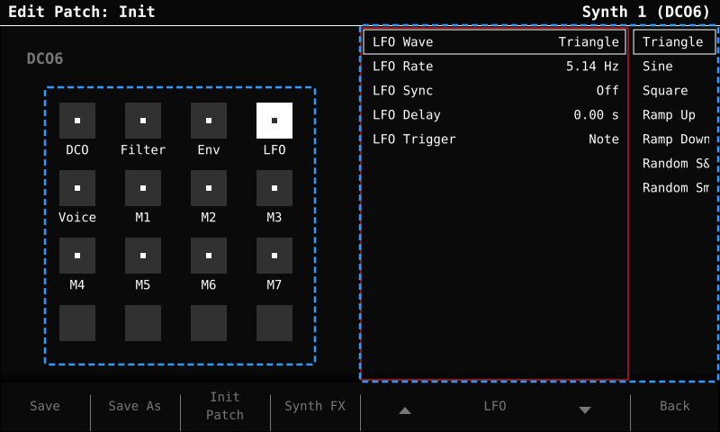

*LFO, with LFO Wave selected: the seven shapes in column 8. Marked: DCO6's tiles and its parameters.*

**Voice**: Unison, Vintage, Glide and Volume, and CE's own Voice Sleep.

| Label | Range | Default | What it does |
|---|---|---|---|
| Unison | Off, 2-8 | Off | how many voices each note takes (see below) |
| Detune | 0-50 ct | 0 ct | spreads a stack's pitches, from −Detune to +Detune; the bottom of the range has the finest steps |
| Width | 0-100 % | 50 % | spreads a stack across the stereo field: 0 % in the middle, 100 % from left to right |
| Vintage | 0-100 % | 0 % | makes each voice a little different and lets it drift: pitch, cutoff, envelope times, pulse width and level |
| Glide | 0-10 s | 0.00 s | slides the pitch from one note to the next; 0 is off |
| Volume | 0-100 % | 100 % | the part's level; the Velocity macro turns it |
| Voice Sleep | Off, On | On | CE's row: On lets silent voices stop working, which saves CPU |

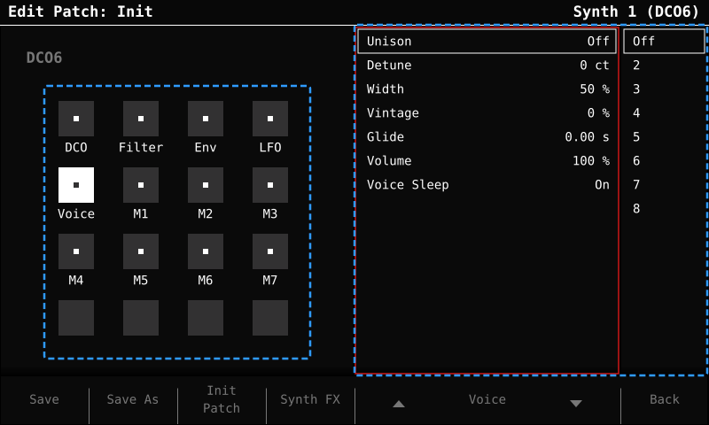

*Voice on the Init patch, with Unison selected: Off, 2 to 8 in column 8. Marked: DCO6's tiles and its
parameters; Voice Sleep is CE's row.*

**Unison** takes the part's voices, set by **Polyphony** on Synth Parameters, and stacks them on each
note. A stack never takes more voices than the part has. The notes you can play at once are the
part's voices divided by the stack, rounded down; voices left over stay unused:

| Polyphony | Unison | Notes at once | Unused voices |
|---|---|---|---|
| 8 | Off | 8 | 0 |
| 8 | 4 | 2 | 0 |
| 7 | 4 | 1 | 3 |
| 4 | 8 | 1 (a stack of 4) | 0 |
| 3 | 2 | 1 | 1 |

The Unison row shows the setting, not the stack it gives: Unison 8 on a part with 4 voices shows 8
and plays a stack of 4. When every stack is busy, a new note takes a stack that's free, then one
whose note has ended, then the oldest. A stack is about as loud as one voice. Changing Unison while
notes are held changes the next notes, not the held ones.

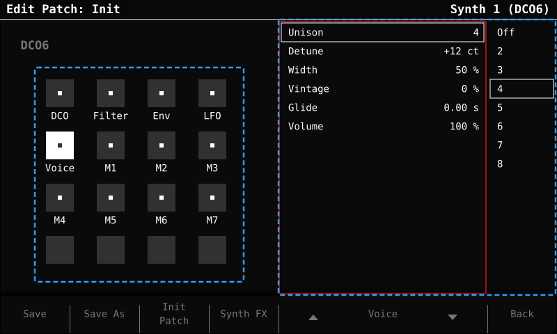

*Voice with Unison 4 picked, Detune at +12 ct and Width at 50 %. Marked: DCO6's tiles and its
parameters.*

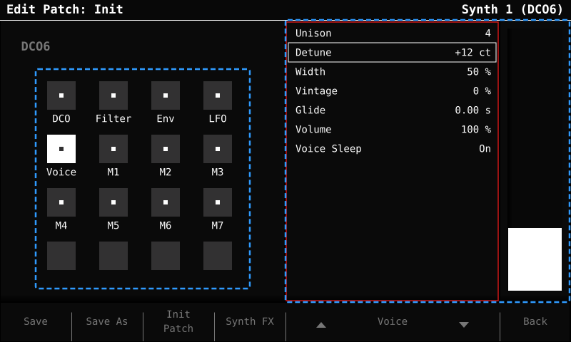

*Voice with Detune selected, at +12 ct: column 8 shows its bar. Marked: DCO6's tiles and its
parameters.*

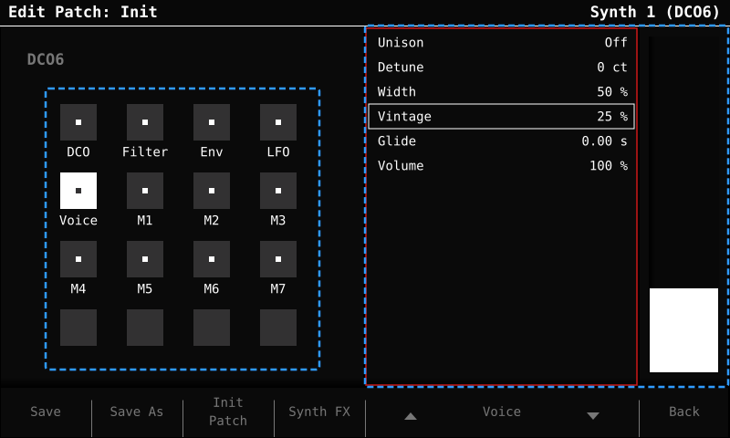

*Voice with Vintage selected, at 25 %. Marked: DCO6's tiles and its parameters.*

At 100 %, Vintage sounds like a well-kept analog synth, not a broken one: each voice is within about
±4 ct of the others, drifts slowly by a few cents, and moves a little at each note.

The macros' parameter lists also show **Unison Place**. DCO6 uses it inside, to tell each voice its
place in a stack: leave it unassigned.

**Cost.** DCO6's own code runs about 18,900 instructions per voice for each block of 128 samples on
the Init patch, measured in the emulator. WAVE's runs about 14,900 and PHASE's 14,100, measured the
same way. That's a count of instructions, not the CPU load on the unit; it hasn't been measured there
yet with the Profiler.
