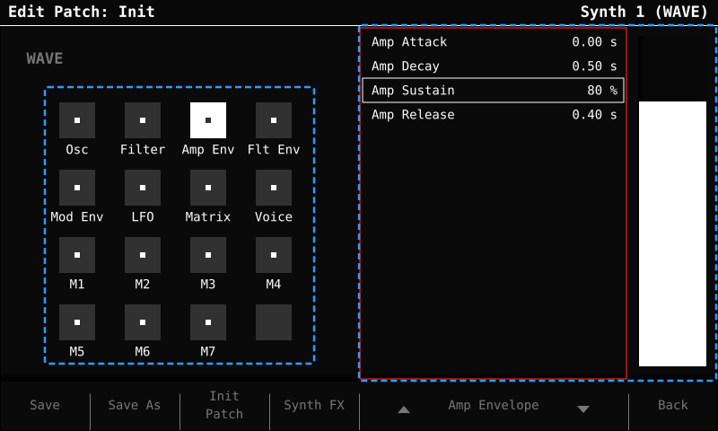
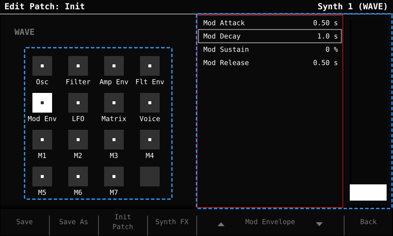
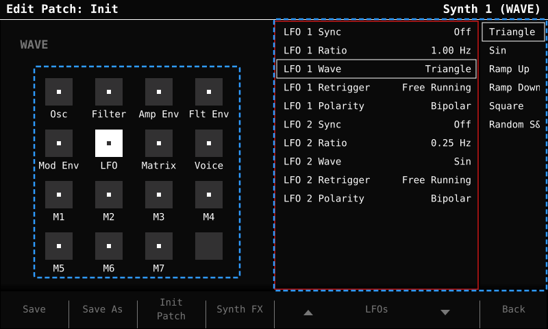
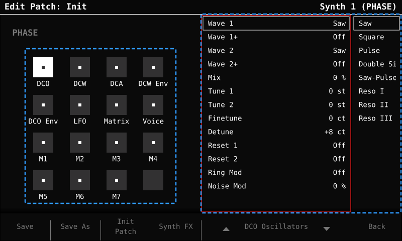
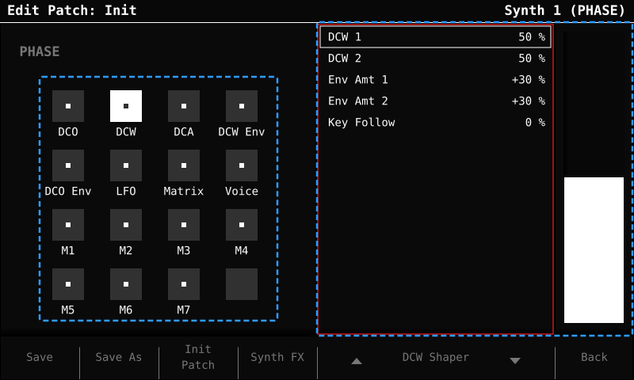
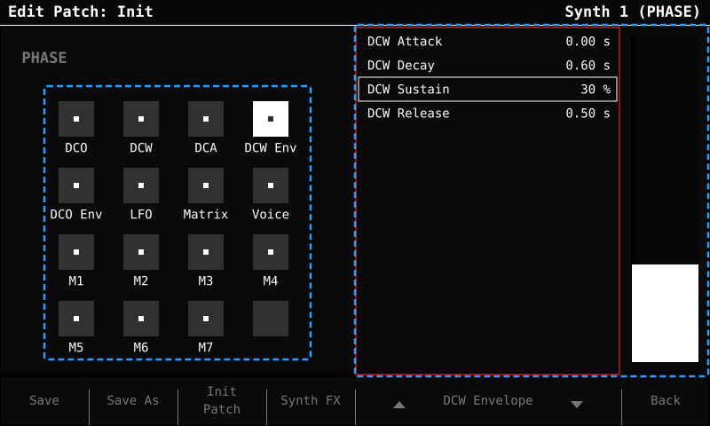
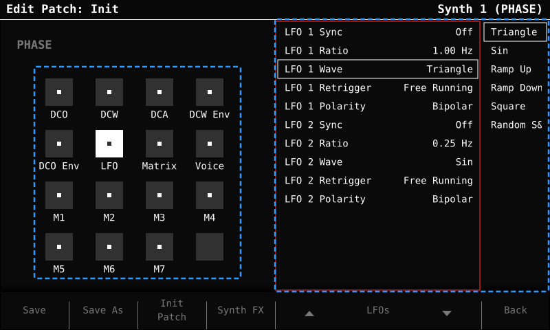

# Synths

Two more synth models for the synth parts: **WAVE**, a wavetable synth with two oscillators, a filter,
three envelopes, two LFOs and a mod matrix, and **PHASE**, a phase distortion synth after the Casio CZ.

- Turn it on in **Project Settings → Mods → Synths** (for new projects: **Config → Mods**).
- WAVE and PHASE are `.psyn` files, `WAVE.psyn` and `PHASE.psyn`, in the card's `Synths` folder beside
  CE's engines. Every release has them in `PolyendTracker_CE_Synths.zip` (install step 3 in the
  [README](../../README.md#install)).
- Their effects are the [Synth FX](synthfx.md) slots, on the Synth FX button in the patch editor.
- Off hides the two models in the picker. A part already playing one keeps it.

The pictures are drawn from the firmware's code, at the screen's 800 × 480. The dashed blue outline
marks what the mod adds. The section icons are drawn as dots, and the font is close to the unit's,
not the same.

## Pick WAVE or PHASE

1. Open a synth part's **Synth Parameters 1/2** screen.
2. Press **Model**. The Model column gets the red frame.
3. Turn the jog wheel, or press Up or Down, to pick **WAVE** or **PHASE**. Pressing **Model** again
   also steps to the next model.
4. Press **Edit Patch** to open the patch editor.

*The Model list with WAVE picked. Marked: the WAVE and PHASE rows. The right label shows the part and
its model, here Synth 1 (WAVE).*

## The patch editor

The patch editor is CE's. With WAVE or PHASE it shows their own sections and parameters:

- **Left:** a tile for each section, then the macros M1 to M7. The open section's tile is white.
  The four left pads of each pad row pick the tile in the same place: the top row of pads is the top
  row of tiles.
- **Middle (columns 5 to 7):** the section's parameters and their values. Up and Down, or the buttons
  under the arrows, move through them. The open section's name is under the list.
- **Right (column 8):** for a parameter with a list of choices, the choices; for a number, a bar.
  The jog wheel changes the value.
- **Save**, **Save As** and **Init Patch** work as on CE's engines. **Back** goes back to Synth
  Parameters.

The pictures show WAVE's and PHASE's Init patch, with each parameter at its default.

### WAVE

**Osc**: the two oscillators. *Wave 1* and *Wave 2* pick each oscillator's wavetable, or Super Saw
or Saw. *Position 1* and *Position 2* move through the wavetable; on Super Saw they set the spread of
its seven saws. *Mix* sets the balance between the oscillators, *Tune* and *Finetune* the pitch, and
*Detune* spreads them apart. *Noise* adds noise. *Digital* On plays the wavetables the way early
digital wavetable synths did: the nearest frame, 8-bit, no smoothing. *Reset* On starts the
oscillator's wave from the beginning at each note.

*Osc, with Wave 1 selected: column 8 lists the nine wavetables. Marked: WAVE's tiles and its
parameters, values and choices.*

**Filter**: *Cutoff*, *Resonance* (up to 150 %), the filter *Type*, *Env Amt* (from the Filter
Envelope), *Key Track* and *Drive*.

*Filter, with Type selected: the filter types in column 8, 14 of the 15 at a time. Marked: WAVE's
tiles and its parameters.*

**Amp Env**, **Flt Env** and **Mod Env**: three envelopes, each with Attack, Decay, Sustain and
Release. The amp envelope shapes the volume, the filter envelope the cutoff (by Env Amt), and the
mod envelope is a source for the matrix.

*Amp Env, with Amp Sustain selected: column 8 shows its bar. Marked: WAVE's tiles and its parameters.*

*Flt Env, with Flt Sustain selected. Marked: WAVE's tiles and its parameters.*

*Mod Env, with Mod Decay selected. Marked: WAVE's tiles and its parameters.*

**LFO**: two LFOs, five rows each. *Sync* On makes *Ratio* a note length instead of a rate in Hz.
*Wave* is the LFO's shape, *Retrigger* restarts it at each note (Note), runs it once (One Shot) or
lets it run (Free Running), and *Polarity* is Bipolar or Unipolar.

*LFO, with LFO 1 Wave selected: the six shapes in column 8. Marked: WAVE's tiles and its parameters.*

**Matrix**: six routings, three rows each: a source (*Src*), a destination (*Dest*) and an amount
(*Amt*, −400 % to +400 %). The Init patch has LFO 1 and the Mod Env routed to Position, at Amt 0 %,
ready to turn up.

*Matrix, with Mod 1 Dest selected: the destinations in column 8. The list scrolls to Mod 5 and Mod 6.
Marked: WAVE's tiles and its parameters.*

**Voice**: *Glide Mode*, *Glide Time* and *Volume*.

*Voice, with Glide Mode selected. Marked: WAVE's tiles and its parameters.*

### PHASE

**DCO**: the two oscillators. *Wave 1* and *Wave 2* pick each one's shape. *Wave 1+* and *Wave 2+*
pick a second shape that the oscillator plays on every other cycle, or Off. *Mix*, *Tune*,
*Finetune*, *Detune* and *Reset* work as on WAVE. *Ring Mod* On puts oscillator 1 × oscillator 2 in
place of oscillator 2. *Noise Mod* roughens oscillator 2 with noise: a roughness at 10 %, noise at
100 %.

*DCO, with Wave 1 selected: the eight shapes in column 8. Marked: PHASE's tiles and its parameters.*

**DCW**: the phase distortion's amount for each oscillator (*DCW 1*, *DCW 2*; at 0 most shapes are a
pure sine), how much the DCW Envelope moves each (*Env Amt 1*, *Env Amt 2*), and *Key Follow*, which
lowers or raises the DCW with the note, around middle C.

*DCW, with DCW 1 selected. Marked: PHASE's tiles and its parameters.*

**DCA**, **DCW Env** and **DCO Env**: three envelopes. DCA is the volume, DCW Env the distortion
amount, and DCO Env the pitch, by *DCO Env Amt* (up to ±48 semitones).

*DCA, with DCA Sustain selected. Marked: PHASE's tiles and its parameters.*

*DCW Env, with DCW Sustain selected. Marked: PHASE's tiles and its parameters.*

*DCO Env, with DCO Decay selected. Marked: PHASE's tiles and its parameters.*

**LFO**: the same two LFOs as WAVE's.

*LFO, with LFO 1 Wave selected. Marked: PHASE's tiles and its parameters.*

**Matrix**: six routings, with PHASE's sources (DCA Env, DCW Env, DCO Env, LFO 1, LFO 2, Velocity,
Key) and destinations. The Init patch has LFO 1 routed to Pitch and LFO 2 to DCW, at Amt 0 %.

*Matrix, with Mod 1 Dest selected: the destinations in column 8. Marked: PHASE's tiles and its
parameters.*

**Voice**: *Glide Mode*, *Glide Time* and *Volume*, as on WAVE.

*Voice, with Glide Mode selected. Marked: PHASE's tiles and its parameters.*
