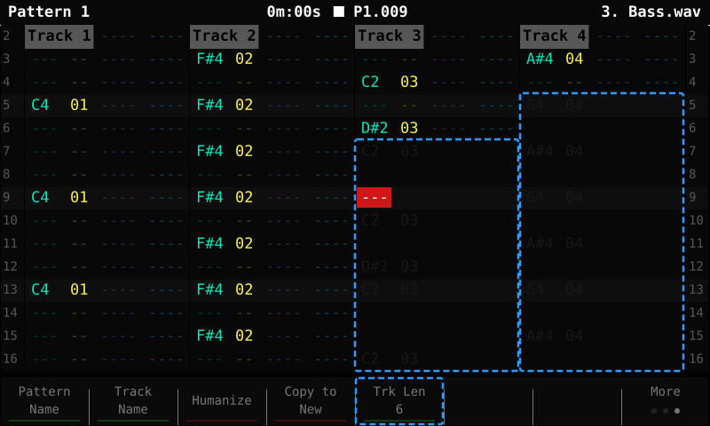

# Variable Track Length

Each track of a pattern can have its own length. A short track plays its own steps over and over,
and every track starts again together when the pattern ends. In a 16-step pattern, a track of
length 6 plays steps 1–6, 1–6, 1–4.

- Turn it on in **Project Settings → Mods → Track Length** (for new projects: **Config → Mods**).
- Off: every track plays the whole pattern, as in CE.

The picture is drawn from the firmware's code, at the screen's 800 × 480. The dashed blue outline
marks what the mod adds or changes. The font is close to the unit's, not the same.

## Set a track's length

1. Put the cursor on the track.
2. Press **More** until the third page of buttons shows. The dots under More show the page.
3. Hold **Trk Len** and turn the jog wheel. The length goes from 1 to the pattern's length; at the
   pattern's length the track plays the whole pattern again.

Trk Len works with Rec on or off. Its second line shows the cursor's track's length, or **--** when
the track plays the whole pattern.

*A 16-step pattern with Track 3 six steps long and Track 4 four, the cursor on Track 3. Marked: the
rows past each short track's length, and Trk Len with Track 3's length. Its place on page 3 depends
on which mods are on: here Humanize, Copy to New and Track Length are all on.*

Past its length, a track's rows show the steps it plays there, in grey, and nothing where those
steps are empty. Track 3 above plays its C2s again at steps 7, 10, 13 and 16, and its D#2 at
step 12.

## How it plays

- The pattern's length still sets when the pattern ends. Song mode, the metronome and the play row
  work as in CE.
- A length counts from 1 to the pattern's length − 1. If the pattern is made shorter than a track's
  length, the track plays the whole pattern; make the pattern longer again and the length comes
  back.
- CE's conditions on the Chance FX count a short track's own loops.

## Saved with the project

The lengths are kept per pattern number, in the project's `mods.bin`. Pattern files aren't changed.
[Copy to New](copytonew.md) gives the copy the pattern's lengths too. A project that used track
lengths with [Modular-Trackular](https://github.com/FatRodzianko/Modular-Trackular) on 1.2.0 brings
them the first time it opens.
